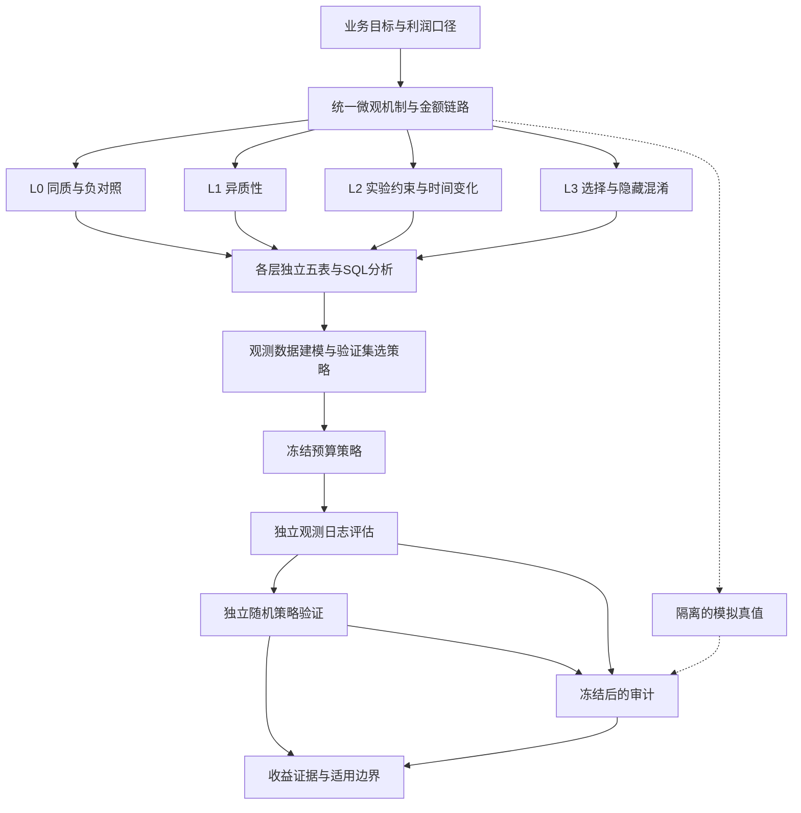

# 完整修订建议：L0–L3 全流程研究与不依赖真值的评估闭环

> 编制日期：2026-10-25。研究属性：合成数据 / 已知 DGP，非真实企业实验。
>
> **状态：待执行的修改建议。本轮只编写本文件，不修改现有代码、配置、数据、图表、论文或进度文件，不启动实验。**
>
> 本建议以用户本轮八项要求为修订目标。下文的目录、接口、实验矩阵和重复次数属于下一版拟实施方案；旧版结果仅用于定位问题，不能充当新版结果。除非明确标注“现有”，以下任务均不表示已经完成。

## 0. 本轮决策记录（HITL，2026-10-25）

用户就八项待定问题给出裁决。**下表是实施约束，与正文任何表述冲突时以本表为准。**

| 编号 | 问题 | 决策 | 对正文的影响 |
|---|---|---|---|
| **Q1** | 正式重复次数 | **（b）分层**：核心格全量执行，矩阵外围格 R=100 并**逐格报告蒙特卡洛标准误** | §8.1 增设分层方案与算力预算；§11.1 的 Phase G 验收改为“分层矩阵全部完成” |
| **Q2** | 多面额子实验（0/5/10/15/20） | **（c）本轮不做**。只保留单一参考面额（10 元），多面额进入展望 | 删除 §4.3 多面额条、§6.2 多臂 DR 条、§8.2 多选背包条；§10.2 目录去掉“3.3.4 多面额决策与约束” |
| **Q3** | 独立验证队列存储 | **同意**：每 rep 生成 20 万用户，但只保留**策略名单、汇总指标与 manifest**；完整五表仅在“代表 rep”保留一套 | §5.1 存储规则、§6.3 |
| **Q4** | L0-Π 可行性 | **（b）引入显式机制旋钮**强制利润 CATE 同质，并**声明这是为构造对照而设的人造机制**，不是业务机制 | §2.5 |
| **Q5** | 路线图概念稿 | **由用户用生图模型完成**；本项目只负责**原生可编辑 PPT 重绘**、SVG/PNG 与图形元素清单 | §9.2 |
| **Q6** | 封面与参考文献 | 封面**不写**单位、机构、致谢（未提供即留空，不编造）；参考文献**不扩充**，维持现有 12 篇；全稿定位为**作品集报告**，不以期刊投稿标准要求文献综述 | §10.1、§10.3 |
| **Q7** | 旧产物处置 | 新产物验收通过后，**旧 `data/` 与 `outputs/` 可删除**；历史只保留在 git 里 | §5.1、§11.4 |
| **Q8** | 阶段验收方式 | **每个 Phase 一次独立子代理评审**，按阶段指派资深数据科学家 / 资深数据工程师 / 资深电商业务专家 | §11.1 增列评审角色；新增 §11.5 评审规程 |

**三条配套说明（避免误读）：**

1. **Q1 的分层不等于降低完成度。** 本文档 1.3 条禁止的是“**静默**降低”，本节把分层方案与每一格的蒙特卡洛精度**显式写进实验清单**，属声明式设计；未列入清单的格子不得以“影响不大”为由跳过。
2. **Q2 删除多面额后**，§2.3 的券抵扣上限 $D_i(a)=\min(a,G_{i,1})$ 仍按单一参考面额执行。面额效应的非线性、门槛券与多选背包**进入展望**，本轮不得声称已验证。
3. **Q6 的“不扩充文献”不改变引文真实性要求**：现有 12 篇已逐条核实存在（见 §7.2 与 `reports/07`），不得新增任何未核实条目；若正文新增了需要出处的方法论断，优先引用这 12 篇中的对应文献，其次才是补充并核实新文献。

## 1. 修订目标与完成标准

### 1.1 重新确立研究主线

研究围绕一个业务问题展开：**在有限预算下，如何依据可观测数据决定是否发券、给谁发券、发多大面额，并验证策略创造的净增量利润及其适用边界。**

四个层级各自完成“机制定义 → 业务五表 → SQL 核算 → 因果估计与机器学习 → 预算策略 → 观测评估 → 独立随机验证 → 真值审计”。它们分别承担同质基线、异质性主场景、时间与实验约束、观察性选择与隐藏混淆的研究任务。

“完整”不是每层都必须得到正向收益，也不是每种方法都必须有效。L0 可以证明没有效应筛选空间，L3 可以证明仅凭既有观测数据无法可靠识别；只要机制、估计、策略、验证和失败解释全部完成，就属于完整结果。禁止为获得漂亮结论重新调参、删掉失败重复或选择性报告。

### 1.2 八项用户要求的落点

| 用户要求 | 对应修改 | 核心验收依据 |
|---|---|---|
| L0–L3 全部深入，工程完整，增加重复 | 每层独立五表与数据库；完整分析和策略；同预算算法对照；正式重复矩阵 | 第4、5、8、11节及逐层覆盖清单 |
| 重画流程图 | 总路线图、四层实验矩阵、观测评估与真值隔离图；原生可编辑 PPT | 第9节 |
| 修正“会亏钱” | 区分净增量、总利润、每元净增量回报；消除二次扣券 | 第3节 |
| 首单与加购金额关联 | 有界正态购买金额比例；首单不超过分配时购物车；复购为首单55% | 第2节及金额链路测试 |
| 不依赖真值的评估闭环 | 独立观测测试、IPW/DR 策略评估、成本与护栏估计、冻结策略后的随机验证 | 第6节 |
| 从20万反算检测能力 | 固定总人数反算 MDE，并以完整 DGP 验证功效 | 第7节 |
| 四部分结构，结果与分析至少50% | 引言、研究方法、结果与分析、结论与展望；结果章节包含讨论 | 第10节及字数/页数审计 |
| 封面、摘要关键词、三级目录 | 前置页独立排版；目录到1.1.1；分页、书签和跳转复核 | 第10节 |

### 1.3 不再以篇幅或计算量替代完成度

- 允许论文扩展到50–100页，不要求为了凑页数注水，也不因原有短稿布局删减核心实验。
- 计算量大时采用任务拆分、缓存、并行资源限额和断点恢复，不静默降低样本量、重复次数或取消某层。
- 下文各阶段按依赖顺序执行，不是“最小版做完即可停”的可选菜单。
- 实施前冻结实验清单与正式配置；若必须变更，应保存版本、理由及影响范围，不能事后只保留有利配置。

## 2. 修改微观机制：加购金额 → 首单 → 复购

### 2.1 购买金额比例的明确解释

将用户提出的“0.7±0.1的正态分布，不大于1”解释为：**原始正态的均值0.7、标准差0.1，并限制在有效比例区间内**。不是均匀分布于[0.6,0.8]，也不是把0.1当作方差。

设分配时真实购物车金额为 \(C_i>0\)，购买金额比例为 \(Q_i\)：

\[
Q_i^*\sim N(0.7,0.1^2),\qquad
Q_i\sim Q_i^*\mid 0<Q_i^*\le1.
\]

主方案使用截断正态抽样：超出区间重抽，或用等价逆分布抽样。不要简单把所有大于1的值压到1，否则会在1处产生额外点质量。0.7与0.1是截断前参数，截断后的均值和标准差应由公式/抽样核验并单独报告，不宣称截断后仍严格等于原值。

若后续用户明确要求“上限裁剪正态”而非“截断正态”，应作为不同配置记录，不能混用。

### 2.2 首单和复购金额

\[
G_{i,1}=C_iQ_i,\qquad G_{i,2}=0.55G_{i,1}.
\]

- \(G_{i,1}\) 为首单商品交易金额；用户没有购买时不生成订单，但模拟器可以事先保存该潜在金额抽样。
- 首单购买金额比例与“是否购买”的概率是不同对象，命名分别使用 `first_order_cart_fraction` 与 `purchase_probability`，禁止均简称“购买比例”。
- 第二单仍只在首单发生且复购条件满足时生成；复购发生概率及其他既有规则不因本次金额修改自动改变。
- 复购单是新一笔购买，不要求首单加复购总额仍不超过初始购物车金额。
- 对同一用户不同券状态，主机制共享同一次 \(Q_i\) 抽样，避免把额外独立抽样噪声误解释为券效果；该耦合是模拟假设，不是现实个体反事实已被识别。
- 本版仍是金额级模拟，不能声称已验证首单的每个 SKU 都属于原购物车。金额包含关系与商品集合包含关系分开说明。

### 2.3 金额、券和退款的边界

1. 不再独立使用旧首单正态客单价生成结果；旧 `aov_mean/aov_sd/aov_min` 退出主生成路径，保留时标注仅供旧版复现。
2. 不得在 \(C_iQ_i\) 外再强加会让首单超过购物车金额的最小客单价。
3. 券抵扣额不得超过首单可抵扣金额。主方案采用实际抵扣额 \(D_i(a)=\min(a,G_{i,1})\)（核销时）；如改为门槛券，必须显式定义资格规则并重算效应和成本，不得暗中混用。
4. 所有金额先明确单位和分币舍入顺序；首单舍入后仍需满足不超过购物车的断言，复购的55%关系允许至多约定的分币误差。
5. `gross_order_amount`、消费者实付、退款、券补贴、手续费、商品成本回收分别定义；旧 `pay_amount` 的命名歧义必须处理。
6. 选择一套一致的账务约定，并列出未核销/核销 × 未退款/退款的核算真值表。若收入已经扣券，利润不得再扣同一券额；若以扣券前总额入账，则券成本只单列一次。此次修订不能在未声明的情况下改变退款后成本承担规则。
7. GMV 采用明确的订单总额口径，另列退款后净交易额。不能把GMV、实收、净贡献利润三个量混称收入。

### 2.4 必须同步重建解析真值

首单金额与购物车关联后，购买者的期望净贡献一般成为 \(A_a(X)\)，不能继续使用原来与用户特征无关的常数：

\[
\tau_\Pi(X)=p_1(X)A_1(X)-p_0(X)A_0(X).
\]

真值计算应对尚未实现的金额比例、退款、核销和复购随机性求期望；不能把已抽到的个体订单金额或个体潜在利润差直接当作 CATE。

- 在简单线性成本、无边界触发时使用截断分布矩解析计算。
- 券抵扣上限等非线性项使用分段积分或带误差容限的数值积分；报告积分精度。
- 用独立高精度蒙特卡洛校验积分结果，并报告蒙特卡洛标准误；不要把含随机误差的差异与任意固定阈值机械比较。
- 旧版利润ATE、标准差、MDE、校准图和策略收益全部失效，需重跑；不得继续引用0.724元、2.86倍等旧数作为新结果。

### 2.5 特别处理 L0 的定义冲突

“购买增量恒为5个百分点”在新金额机制下不再保证利润 CATE 恒定。L0 必须拆出两种明确场景：

- **L0-P：购买概率效应同质。** 固定基准购买率和购买概率增量，允许金额机制诱导利润效应差异。用途是基础业务核算和识别“购买效果同质不等于利润效果同质”。
- **L0-Π：利润效应同质（采用显式机制旋钮，Q4=b）。** 保留购物车—订单金额关系。先按原方案做**可行性诊断**：仅靠合法范围内的购买概率能否把利润 CATE 对全部用户校成常数，给出可行域。若不可行，则**引入一个显式的、按用户可调的利润调节旋钮** $\kappa(X)$（例如对毛利率或履约成本施加乘子），用它把利润 CATE 校准到指定常数。该旋钮只存在于本层这个**控制场景**，必须满足四条：
  1. 在配置、文档、图表标题与论文正文中统一标注为「**同质化旋钮（control knob，非业务机制）**」，不得出现在 L1–L3 的生成机制里；
  2. 取值满足合法边界（毛利率 > 0；除非显式声明，单笔利润不为负）；
  3. **报告旋钮的取值分布与触发比例**。若需要极端取值才能对全部用户实现同质，说明该同质点不在自然机制的可达域内，此时如实报告「只在子集上同质」，并把这个子集与全体的差异写进结论，不得用「已实现同质」一笔带过；
  4. 不得用裁剪购买概率的方式伪造同质（旧做法），也不得在报告里省略旋钮的存在。
  旋钮不是作弊，它是控制场景的必要构件；但它必须显形，否则同质结论无法解释。

L0-Π 中用于检验“没有个性化价值”的策略对照还须控制成本：等成本或成本与特征无关的对照必须存在。否则，效应相同仍可能通过成本筛选提高预算利用率。

## 3. 统一利润、购买率与经营解释

### 3.1 修正“回报小于1就是亏钱”

\[
V_{\rm inc}(\pi)=E[\Pi(\pi)-\Pi(0)],\qquad
R_{\rm net}=\frac{N V_{\rm inc}(\pi)}{C_{\rm coupon}(\pi)}.
\]

如果分子已经是扣券后的净增量利润，\(R_{\rm net}=0.73\) 表示每投入1元券成本带来0.73元**额外净贡献**，不是亏损0.27元。正负判断以 \(V_{\rm inc}\) 相对0为依据；是否满足企业收益门槛是另一个预设标准。

必须区分：净增量为负、总体经营利润为负、回报不及目标、统计证据不足、预算不可行。这五种判断不得互相替代。

全局检查报告、论文、图题、配置注释和讲解材料中“亏钱”“盈亏平衡”“回本”“ROI”“再减优惠券成本”等表述。配置中以“预算/人数”解释已扣券利润MDE为盈亏平衡线的说法也要修正。

### 3.2 利润分解改成先两项、再三项

先展示恒等式：

\[
\Delta\Pi=p_1A_1-p_0A_0=(p_1-p_0)A_1+p_0(A_1-A_0).
\]

再按一致的购买者平均券成本 \(c\) 拆分：

\[
\Delta\Pi=(p_1-p_0)A_1-p_0c+p_0[(A_1+c)-A_0].
\]

明确这是按组均值进行的核算分解。三项不自动对应可识别的个体类型或独立因果机制。给出全部券成本与图中“基准购买规模补贴”的关系，避免重复扣减的误读。新增金额边界和退款规则后，\(c\) 必须使用一致的净券成本定义，不再默认等于面额乘一个固定核销率。

### 3.3 可读术语和统计解释

- 主文优先使用“7天支付购买率”，首次注明业务上称支付转化率；区分百分比和百分点。
- 区分用户利润分布、CATE分布、估计量重复分布、预测值标准差和标准误。
- 低假阳性率不自动优于名义水平；AA通过不等于全系统正确。
- 非劣效通过表示证据支持恶化小于预设界值，不等于没有恶化或完全安全；低功效不自动取消一次有效通过的证据。
- 条件于已购买的退款比例存在处理后选择，作为辅助描述，不能直接解释成同类用户退款质量的因果改善。

## 4. L0–L3 的完整研究矩阵

### 4.1 各层共同必做的闭环

每个正式场景均应完成下列交付，不再只为 L1 实现：

1. 机制说明、参数依据、可观测变量与审计变量清单。
2. 原始五表、污染版/清洗版血缘、逐表数据字典和质量检查。
3. SQL 聚合的用户级分析表、分组指标、渠道分析、时间分析和成本账。
4. 与场景相符的 ATE/CATE 估计，至少包含常数基准、T、S、CF；观察性场景另加 DR-learner。
5. 固定总样本的MDE/功效和护栏能力评估。
6. 无券、随机、业务规则、定向贪心、局部改进、背包/MILP对照、真值基准及预算扫描。
7. 不依赖真值的价值、成本、护栏和策略差值评估。
8. 冻结策略后使用独立随机验证数据检验策略效果。
9. 最后解封真值，审计偏差、覆盖率、模型误差、regret和上线决策错误。
10. 正式重复、失败记录、运行时间/内存、可复现图表与逐层结论。

“适应对应层级”不等于换一套算法名称。实验设计、时间切分、识别假设、目标人群和评估方式必须随场景调整。

### 4.2 L0：完整基线与负对照

**问题：在最简单条件下，系统是否正确？没有真实差异时，模型会不会制造差异？**

- 完成 L0-P 与 L0-Π，另设无效应负对照。购买效应为零但发券仍产生补贴成本时，利润效应可能为负，不能误称“利润零效应AA”。真正AA须两个标签对应相同处理条件与同一结果机制。
- ATE：ITT、已知随机分配概率的IPW/DR；检查偏差、标准误与覆盖率。
- CATE：对比常数、T、S、CF，检查假异质性、错误排序、过度筛选；真实CATE恒定时，相关系数、R²等不可定义指标记为NA，不硬填漂亮数值。
- 策略：分别在等成本和异质成本下研究定向价值，将效应筛选与成本筛选贡献分开。
- 观测闭环：估计同预算定向相对随机的差值并进行独立随机验证，允许结论为无优势或负优势。
- 必交图：完整DGP AA、假异质性分布、同质场景策略比较、观测估计对独立随机验证、真值审计。

### 4.3 L1：异质性估计与决策优化的主场景

**问题：可观测特征包含多少可学习的增量信息，如何变成预算收益？**

- 每次主实验20万人，默认训练10万、验证4万、测试6万；按用户隔离。
- 正式比较常数基准、T、S、CF、DR-learner；所有主模型使用同一批重复数据和拆分，不再给CF只有2次的例外。
- 调参、校准、阈值和模型选择只使用训练/验证中的观测数据指标；真实CATE只在最终审计使用。
- 对比购买倾向排序、预测利润排序、预测增量排序和增量/成本排序，回答“找容易购买的人”与“找受券影响的人”的区别。
- 扫描异质性强弱、特征信号强弱、模型错设、MAR缺失、金额比例和核销成本预测误差；报告增益何时消失。
- 二元参考券（10 元）为基础主线。**多面额子实验（0/5/10/15/20 元）本轮不做**（决策 Q2=c）：没有多臂分配日志支持时，不得从单一 10 元券日志外推其他面额的策略价值。面额效应的非线性、门槛券与多选背包**进入展望**，本轮结论不得声称已验证面额选择能力。
- 必交图：同源预测—真值、观测分组效果校准、学习曲线、正式重复分布、成本校准、预算价值及收益边界。

### 4.4 L2：实验约束与时间迁移分别检验

**问题：有限数据、分流与时间变化如何影响检测、估计和后续策略？**

主基准仍为20万人，不再把6万人作为L2默认总量。6万人可保留为明确标注的样本量压力点。

建立因素对照：

| 因素 | 主比较 | 必须固定的条件 |
|---|---|---|
| 总样本量 | 3万、6万、10万、20万 | 效应机制、分流比例、目标人群 |
| 分流比例 | 50/50、30/70、10/90 | 总人数20万、效应机制 |
| 时间效应 | 不漂移、平滑衰减、突变 | 总人数、基础人群；明确目标时间段 |
| 人群构成变化 | 无变化、可观测渠道/新客占比变化 | 与效应漂移分开，并增加联合压力点 |
| 记录延迟与成熟窗口 | 正常、延迟、未成熟数据误用对照 | 按真实事件时间和分析截止时点审计 |

- 人数和分流采用交叉矩阵；时间与人群因素先做配对对照，再做预先指定的联合压力场景，不把多个变化只汇成一根误差棒。
- 周次写入真实分配时间；订单、退款及入库时间与之协调，禁止模拟器有周次而五表仍统一铺在三天。
- ATE 同时报告各周效应、指定人群加权效应、错误合并的对照。已知非等比例分流使用设计概率；不能把时间构成变化混成处理效应。
- 学习评估采用前期训练、中期验证、后期测试和滚动起点；同用户跨期时禁止穿越，置信区间按用户/时间依赖采用合适的聚类或时间块方法。
- 必须比较含时间特征、滚动重训和静态模型，并把冻结策略在未来时期的价值变化画出来。
- 测试集必须利润成熟；每次滚动训练的可见数据由当时截止日期决定，不能提前使用未来退款或第二单。
- 必交图：MDE/功效曲面、区间宽度因素分解、逐周效应、未来期策略收益、漂移诊断与重新部署决策。

### 4.5 L3：固定真值的隐藏混淆与观测决策风险

**问题：运营选择、隐藏变量和重叠不足如何破坏估计与决策？能否识别无法下结论的情况？**

将原来一个 \(\lambda\) 分为：

\[
e(X,U)=\sigma(\alpha_0+\alpha^TX+\lambda_TU),\qquad
p_0(X,U)=\sigma(\beta_0+\beta^TX+\lambda_YU).
\]

设置三条都要执行的研究分支：

1. **固定真值主扫描。** 固定 \(\lambda_Y\)、X、U分布和全部潜在结果，只扫描 \(\lambda_T\)。每次配对重复内总体ATE保持不变；通过校准发券截距保持目标发券比例，避免把分流比例变化也混进去。保持比例不等于消除U导致的选择偏差。
2. **结果机制联合变化。** 保留旧版 \(\lambda_T=\lambda_Y\) 扫描，明确其同时改变选择、基准购买和利润ATE，用它研究机制敏感性，不当作纯混淆实验。
3. **重叠与分布压力。** 分别改变倾向得分极端程度、U分布（Logistic、正态、有界对照），区分未观测混淆与重叠不足。尽量匹配最终U的均值、方差和范围；不匹配处必须报告，不能把尺度变化误当形状效应。

- ATE：Naive、PSM、IPW、DR，逐一声明目标是ATE、ATT还是匹配后人群效应。PSM不能把ATT与总体ATE硬比；当前无隐藏混淆时覆盖不足必须先审计目标与标准误，不带着错误基线直接讨论隐藏混淆。
- CATE：T/S/CF/DR-learner使用观测X训练，明确随机森林或DR名称不能修复不可识别性；报告由这些估计导出的预算策略在观测评估和随机验证中的差异。
- 真值条件层次分开：生成器可计算 \(E[\Pi(1)-\Pi(0)\mid X,U]\)，而仅使用X的学习器目标应为对U积分的 \(\tau(X)\)。不得用条件于(X,U)的个体真值替代学习器可识别目标来计算RMSE。策略总价值审计可对完整潜在机制积分。
- 无U影响/仅可观测混淆时，评估可忽略性下的统计表现；存在隐藏混淆时，观测估计只作为依赖假设的结果，不宣称无偏闭环。
- 用独立随机探索/策略验证数据补上确认环节，记录“历史观测评估判断值得投放，随机验证不支持”的错误决策率。
- 必交图：固定真值偏差与覆盖率、PSM目标核对、权重/有效样本量、模型策略的观测与随机验证差距、U分布敏感性、决策损失。

## 5. 四层统一的数据工程与复现机制

### 5.1 每层每场景都有可追溯的五表

建议采用以下目录结构，具体接口在实施时统一命名：

```text
data/v3/<level>/<scenario>/rep_<id>/
  raw/                 # 原始业务五表
  dirty/               # 指定脏数据场景或可重建的污染增量
  clean/               # 去重、合法性修复后的业务数据
  marketing.db         # 五表、视图与SQL分析结果
  analysis/            # SQL导出的可观测分析表与分割标记
  manifest.json        # 配置哈希、种子、版本、行数、校验摘要
audit/v3/<level>/<scenario>/rep_<id>/
  truth/               # 解析真值、潜在结果、U、真实观察性倾向得分
outputs/v3/<level>/<scenario>/rep_<id>/
  estimates/ policies/ evaluation/ diagnostics/ logs/
```

- 五表仍为 users、user_events、coupon_assignment、orders、user_outcomes，允许添加运行、周次、处理动作、设计概率及入库时间等必要字段。
- 主键至少结合运行标识与用户标识；不同层或重复出现相同user_id不得被错误连接。
- 随机实验的分配概率是合法设计元数据，可以进入分析；L3依赖U的真实倾向得分只能留在审计区。
- 五表原始记录保留；清洗需要估计的填补值、截尾阈值只能用训练部分拟合。SQL导出后按拆分拟合的变换仍须可追溯，不允许全量填补再切分。
- 主分析必须消费五表经SQL得到的观测结果，不再绕过它们从潜在结果对象直接取训练/评估结果。快速数组路径保留为工程对账和通过一致性门禁后的加速实现。
- 正式重复均生成并完成五表/SQL链路。可按批运行，允许压缩、分区存储或保存可无损重建的重复版本差量；不能只存一个种子就声称全部业务链路已执行，也不能因磁盘压力静默省略某层。
- **存储分级（决策 Q3）**：每层每场景保留**一套“代表 rep”**的完整五表 + 数据库 + SQL 分析表 + 真值；其余重复只保留压缩五表（或可重建差量）、SQL 结果与 manifest。独立验证队列按 §6.3 的规则存（名单 + 汇总 + manifest）。**判断标准**：任何人拿到仓库后，能在不重跑的前提下核对正文每一个数字；但不需要能逐 rep 重新打开数据库。
- **旧产物处置（决策 Q7）**：v3 全部验收通过后，删除 v2 的 `data/` 与 `outputs/`（`paper/main.pdf` 的 v2 版本由 git tag `v2.0` 保留）。删除前必须先确认：v3 的正文、图表、摘要全部只引用 v3 产物，且 `07_check_consistency.py` 与数字追溯检查通过。删除动作要单独提交，便于回滚。
- 每层主场景至少保留一套可直接查询的完整数据库和CSV示例；其余重复保留压缩五表、SQL结果与manifest，数据库可从五表重建。

### 5.2 必需的SQL分析与校验

各层执行：主外键与重复分配、按用户分组、购买漏斗、分渠道/新老客分层、逐期统计、退款保留、多单求和、实际券额、成熟窗口、延迟入库、分配概率与分流检查。

增加金额关联断言：首单不超购物车；复购为首单55%；无首单不应有复购；券不超可抵扣额；未购买用户利润为0；退款订单不删；各组件求和与净利润一致。

脏数据与DGP层级正交：渠道相关缺失在当前规则下称MAR；MNAR若要研究，另设缺失概率依赖未观测真实金额的明确子场景，不更改名称掩盖机制差别。日志上限造成的事件缺失应显式建模，不允许字典说“等于行为次数”而实际被裁剪。

### 5.3 运行、失败和资源记录

建立统一编排，能按level/scenario/repetition运行、恢复和汇总；未来的全量入口应覆盖数据、SQL、设计、模型、策略、观测评估、随机验证、审计、图表、论文及一致性检查。

记录所有尝试、失败类型、超时、重试和耗时；失败后改变参数须成为新配置版本。重复实验共享配对种子以比较方法，同一方法的不同重复使用独立派生随机流。并行任务限定线程数，避免模型内部并行与任务并行相乘导致资源耗尽。

## 6. 新增不依赖真值的评估闭环

### 6.1 三套角色严格隔离

1. **学习与决策侧：** 只读取X、处理分配、观测利润、核销成本、退款与合法设计元数据。
2. **观测验证侧：** 独立测试日志与独立随机验证日志；不读取反事实、真实CATE、U和L3真实倾向得分。
3. **模拟审计侧：** 在模型、策略、区间和决策冻结后读取真值，核查误差和风险。

用接口白名单、路径隔离和集成测试实现，不依靠注释提醒。审计输出不得反流到同一次实验的模型选择、阈值选择或确认性报告。

### 6.2 只用观测数据的策略价值

对冻结的二元策略 \(\pi(X)\)，用独立评估样本估计相对不发券的净增量：

\[
\widehat V_{\rm IPW,inc}(\pi)=\frac1n\sum_i\pi(X_i)
\left[\frac{T_iY_i}{\widehat e_i}-\frac{(1-T_i)Y_i}{1-\widehat e_i}\right].
\]

DR增量估计使用：

\[
\widehat V_{\rm DR,inc}(\pi)=\frac1n\sum_i\pi(X_i)
\left[\widehat m_1(X_i)-\widehat m_0(X_i)
+\frac{T_i(Y_i-\widehat m_1(X_i))}{\widehat e_i}
-\frac{(1-T_i)(Y_i-\widehat m_0(X_i))}{1-\widehat e_i}\right].
\]

这里 \(Y_i\) 是已扣券的观测净利润；不再扣券。两式均不需要个体反事实。随机日志优先使用真实记录的设计分配概率；观察性数据只能估计倾向得分，并声明可忽略性与重叠假设。不能将“估计倾向得分+截断权重”的结果宣称为有限样本严格无偏。

- 结果模型和倾向模型采用交叉拟合，避免同一条评估结果用于拟合自己的残差修正项。
- 学策略、调阈值与最终评策略分离；预算批量选择只能使用测试时合法可见的X及冻结规则，不能用测试Y重新优化。
- 同预算策略差值用同一评估样本计算配对差及区间；比较策略所需的协方差不能忽略。
- 同时实现SNIPS/归一化估计作为敏感性对照，报告其偏差—方差权衡；不把截断当作没有代价的修复。
- 分别估计核销成本、退款等护栏，报告有效样本量、最大权重、重叠分布、成本预测误差和实际预算超支概率。
- 没有观测支持或有效样本量过低时，输出“无法可靠评估”，而非强行给排名。

多面额子实验（动作集合 $a\in\{0,5,10,15,20\}$ 与多臂 DR）**本轮不做**（决策 Q2=c）。因此本轮所有策略价值都定义在单一参考面额 $a=10$ 上：$V(\pi)$ 表示「发 10 元券 vs 不发券」的净增量。**不得**把这一结论改写成「选择最优面额」的能力；面额外推、多臂估计与多选约束一律留在展望。

### 6.3 独立随机验证完成闭环

每个主场景在策略冻结后，另生成独立用户批次作为验证数据。规模默认 20 万人，明确是**额外的验证队列**，不能混进原 20 万人训练数据。

**存储规则（决策 Q3）：** 验证队列每次重复都**生成** 20 万用户并完成随机化，但**只保留**三样东西——策略名单（每用户的分臂结果）、汇总指标（各臂 ITT 与区间）与 `manifest`（配置哈希、种子、行数）。**完整五表只在“代表 rep”保留一套**（每层每场景各一套），用于展示与审计。这样既保住“每次都真的跑了完整队列”，又不会因 200 次 × 4 层 × 20 万行把磁盘打满。

随机分配用户到策略臂，例如不发券、同预算随机发券、定向发券。各策略臂具有可比的人均预算，按策略臂的全部被分配用户计算ITT；不能只比较各臂中实际收到券的人。多臂分流后人数不再是每组10万，需按真实臂规模重算检测能力。

流程为：历史日志建模 → 验证集选策略 → 冻结规则与预算 → 独立日志OPE → 预先约定的决策门槛 → 独立随机策略试验 → 比较预测收益与验证收益 → 最后解封模拟真值。

L3隐藏混淆时，旧日志OPE不保证可信；独立随机验证提供不同的识别依据。若无法获得这类随机数据，研究必须明确保留“因果价值未确认”，不能以DR替代缺失的识别条件。

随机验证仍然是模拟的随机试验，不能写成真实平台上线。未来期验证必须说明人群/时间是否与历史一致，避免将迁移误差与估计偏差混为一谈。

### 6.4 不确定性必须分类

- 固定策略的评估样本不确定性：影响函数或用户级bootstrap；时间依赖时用时间块/聚类。
- 学习流程不确定性：重抽训练与验证、重新拟合、重新选择策略，再在独立评估样本上比较。
- 随机发券种子波动：描述随机名单的分布，不冒称总体均值的置信区间。
- 重复DGP的蒙特卡洛误差：报告重复数、标准误和覆盖率区间。
- 不再未经独立性论证就把“条件标准差”和“再训练标准差”平方相加；不用均值±1.96×重复标准差冒充均值置信区间。
- 覆盖率分别对准冻结策略的条件价值、学习流程的平均表现等明确目标，不能把不同目标混在一个“95%区间”里。

## 7. 从固定20万人出发评估检测能力

### 7.1 主叙述改为固定资源设计

不再以“先算约3万人、实际用20万人”作为核心样本设计结论。主问题改为：**固定20万人及分流方式，能够以给定功效检测多小的购买率和利润增量？**

利润近似MDE：

\[
\mathrm{MDE}_\Pi=(z_{1-\alpha/2}+z_{1-\beta})
\sqrt{\frac{\sigma_1^2}{n_1}+\frac{\sigma_0^2}{n_0}}.
\]

购买率MDE用两比例功效关系数值反解，基准购买率、两组人数、双侧/单侧和校正方式均记录。单项MDE与多重比较后的联合检测能力分别报告。

- 旧金额机制下的0.379个百分点、0.139元仅为历史解释，不能直接作为新版本结果。
- 新利润方差来自独立模拟先导数据或训练/设计样本，不能读最终测试真值后确定检测目标。
- 同时给出80%、90%功效，50/50、30/70、10/90分流；L2扩展人数扫描作为资源压力分析。
- 20万总队列、10万训练、6万测试以及额外验证队列的检测能力分开列，不能用总20万的MDE代表仅6万测试集的能力。
- 隐藏混淆的观测研究不能把随机实验MDE当成“可检测真实因果效应”的保证；需另报有效样本量、方差和敏感性。

### 7.2 用完整DGP验证功效与AA

从微观购买机制产生局部效应网格，维持合法概率和对应目标，不直接给最终利润随意加常数来伪造业务机制。报告目标效应、实际达到的解析效应、检出比例及其蒙特卡洛区间。

完整AA必须走五表、污染/清洗、SQL及估计流程：同一处理条件下分配虚拟A/B标签，两个标签不改变购买、券成本或退款机制。原二元/正态AA保留为检验模块单测，明确与完整AA分开。

护栏单独进行非劣效功效设计。界值来自明确业务容忍情景，不能根据结果反选；退款以新复购与金额规则下的用户级事件定义计算，不能沿用旧首单退款率差作为“任一单退款”的真值。

## 8. 正式重复次数与优化算法验收

### 8.1 默认正式重复方案

| 工作 | 正式重复要求 | 统计含义 |
|---|---|---|
| 完整DGP AA | 每个预设无效应主场景1000次 | 假阳性率及其区间 |
| 四层主要ATE估计 | 每个核心场景500次 | 偏差、RMSE、标准误校准、覆盖率 |
| CATE与完整策略学习 | 四层每个核心场景、每个主模型200次；CF同样200次 | 使用配对数据比较精度、排序和决策价值 |
| L2因素矩阵、L3七点主扫描 | 每个预设单元至少200次完整分析与策略评估 | 不只重复廉价均值估计而让模型跑一次 |
| 分布/参数扩展敏感性 | 每格100次；论文据此给边界判断的关键点增至200次 | 报告蒙特卡洛精度，禁止择优补跑 |
| 独立随机策略验证 | 每个核心场景对应200次冻结策略验证 | 衡量可复制收益及错误上线决策 |
| 固定策略bootstrap | 需要bootstrap的评估采用1000次 | 不与DGP重复次数混称 |
| 完整再训练bootstrap专题 | 每层代表性场景至少200次 | 不再仅10次后宣称稳定 |
| 随机名单基线 | 每个冻结数据/预算点200个随机种子 | 相同成本约束下的随机策略波动 |

同一次200次完整流程可同时产生模型、策略、OPE和随机验证结果，不必为相同输入重复拟合。ATE的500次中可复用前200次完整流程，并额外执行300次估计校验。上述要求以冻结的场景清单计数，须报告计划数、成功数、失败数和有效数。

200次、真实覆盖率约0.95时，覆盖率估计标准误约0.015；500次约0.010。禁止把有限重复的覆盖率必须等于0.95当作验收，也不能为了进入某个窄区间选择种子。

### 8.1.1 分层方案与算力预算（决策 Q1=b）

正式矩阵分两层。**分层是声明式设计，不是静默降级**：每一格实际执行的 R、以及由此得到的蒙特卡洛精度，都要写进实验清单和结果表。

**Tier 1 — 核心格，按 §8.1 表全额执行**

| 内容 | R | 备注 |
|---|---|---|
| 完整 DGP AA（走五表 / 清洗 / SQL / 估计） | 1000 | 每层 1 个无效应主场景 |
| 四层主场景 ATE | 500 | 每层主场景 |
| CATE + 完整策略学习 | 200 | 每层主场景 × 4 模型（常数 / T / S / CF）；**CF 同为 200，不再有例外** |
| 独立随机策略验证 | 200 | 每层主场景 |
| 固定策略 bootstrap | 1000 | 评估侧抽样不确定性 |
| 再训练 bootstrap | 200 | 每层代表场景 |
| 随机名单基线 | 200 个种子 | 每个冻结数据 / 预算点 |

**Tier 2 — 矩阵外围格，R=100，逐格报告 MC 精度**

| 内容 | R | 该格可判定的精度（近似） |
|---|---|---|
| L2 样本量扫描：3 万 / 6 万 / 10 万（20 万在 Tier 1） | 100 | 覆盖率 SE ≈ 0.022；偏差 SE ≈ sd/10 |
| L2 分流扫描：30/70、10/90（50/50 在 Tier 1） | 100 | 同上 |
| L2 时间漂移（平滑衰减、突变）、人群构成变化、延迟 / 成熟窗口 | 100 | 同上 |
| L3 固定真值 $\lambda_T$ 七点中除基准外的 6 点 | 100 | 同上 |
| L3 $\lambda_Y$ 联合变化、重叠与分布压力 | 100 | 同上 |
| 参数 / 分布扩展敏感性 | 100 | 同上 |

**报告要求（硬性）**

1. Tier 2 的每一格在结果表里必须带 `R` 与 `MC_SE` 两列；正文引用 Tier 2 数字时必须同时给出精度，例如「覆盖率 0.88（R=100，SE≈0.022）」。
2. **禁止**把 Tier 2 的结论写成与 Tier 1 同等强度；凡进入摘要或结论的定量断言，必须来自 Tier 1。
3. 实验清单要同时列出「计划格数 / 已完成 / 失败 / 有效」，Tier 1 与 Tier 2 分开统计。

**算力预算（本机：8 物理核 / 16 线程 / 30.8 GB 内存但仅约 8.4 GB 可用）**

| 项 | 估算 | 依据 |
|---|---|---|
| Tier 1 的 CF 拟合 | ≈ 5.6 CPU·h | 4 层 × 200 次 × 约 25 s |
| Tier 1 的完整 AA | ≈ 17–33 CPU·h | 4 层 × 1000 次 × 15–30 s（含五表 + SQL） |
| Tier 1 其余（ATE 500、OPE、验证、bootstrap） | ≈ 10 CPU·h | — |
| Tier 2 全部 | ≈ 8 CPU·h | 约 30 格 × 100 次 × 约 10 s |
| **合计** | **约 40–55 CPU·h** | 4–6 并行下约 **8–12 小时**墙钟 |

上述数字是**估算，不是承诺**。Phase D 开始前必须先跑 **20 次 pilot** 实测单 rep 成本（分别测“纯估计”“含五表+SQL”“含 CF 拟合”三种粒度），用实测值重排工期；若实测比估算高 50% 以上，回来重新商定 Tier 2 的格数与 R，而不是悄悄削减。

**内存纪律**：并行度上限 6；每 rep 落盘后释放，不得把 20 万样本整体读入多份；CF 拟合期间限制 `n_jobs`，避免模型内部并行与任务并行相乘（8 核会瞬间打满）。

### 8.2 背包、局部改进和LP应各自名实相符

- 正式策略包含贪心与贪心后局部交换，分别命名；不能继续把局部交换称为背包DP。
- 小规模上同时使用分币精确成本DP或经证明的MILP，以及枚举反例，核对可行性与最优值。
- 大规模可以使用时间受控MILP并报告上下界/最优间隙；未证明最优不得写“最优”。DP不适合全量时，交付完整的规模—精度—耗时比较，而非只说算不动。
- 成本桶宽逐级收敛实验必须执行。离散化DP加删项修复只称近似解；“贪心超过最优”必须触发口径审计。
- LP上界、贪心解需使用完全相同的目标和成本。预测目标上的最优间隙与真实利润regret分开，不把一个数替代另一个。
- **多面额多选背包不在本轮范围**（决策 Q2=c）。本轮只有一个券面额，问题退化为 0-1 背包；多选约束、每用户至多一个面额、面额间替代性全部留到展望。若报告中出现“面额优化”字样即属越界。
- 每层都对比优化误差和学习误差。L0成本控制、L2未来收益、L3错误识别导出的策略均纳入，不预设贪心一定很好。

## 9. 重画技术路线图与结果图体系

### 9.1 总路线图必须展示真实依赖

拟采用上下主流程与四层并列实验区：



该Mermaid是关系草稿，不是最终排版。主图不能再把只有L1落五表画成所有层已经贯通，也不能让真值箭头进入学习、调参和上线决策。

### 9.2 图形交付

图形分工（决策 Q5）：**布局概念稿由用户用生图模型完成**，本项目不承担文生图环节。本项目的交付是——按概念稿用 PPT 原生形状、文本与连接线重绘的**可编辑 `.pptx`**，以及导出的 SVG/PNG 与一份图形元素清单（每个形状的名称、层级、对应业务含义）。重绘时必须校正文字与箭头，不得把概念稿当底图贴上去。

交付至少三张方法图：总路线图、四层实验矩阵、观测决策与真值隔离图。结果图不再强行压成六张：按研究问题增加分层组图，避免一图混放多种目标、分母或不确定性。

所有图逐项注明level、场景、总人数/测试人数、重复数、目标量、区间含义；购买率与利润用清楚的单位。图题只描述结果支持的结论，“稳定优于”“校准正确”“全流程区间”等强表述必须有对应证据。

## 10. 论文结构与版式重建

### 10.1 前置页

1. **封面页：** 主标题、副标题、作者姓名与邮箱、日期/版本、合成数据属性；封面不与摘要挤在同页。**不写单位、机构、基金与致谢**（决策 Q6）——未提供即留空，禁止编造任何机构名。作者信息以 `Lrvin / liliw@126.com` 为准。
2. **摘要与关键词页：** 摘要可占满一页，约900–1300中文字符作为初始排版参考；涵盖问题、四层机制、工程链路、观测闭环、关键结果、失败边界和局限。新版结果未完成前只写结构占位，不能填入旧数。关键词约5–8个，置于同一摘要页。
3. **目录：** 独立起页，显示至三级标题（如3.2.1），页码与PDF书签可点击；三级目录较长时允许自然延伸多页，不为“一页目录”缩小字体或删三级条目。
4. 前置页使用独立页码规则，正文重新开始阿拉伯页码；图表目录可增设但不替代三级正文目录。

### 10.2 正文仅设四个顶层部分

以下为可直接细化的三级目录建议：

```text
1 引言
  1.1 业务问题与决策困境
    1.1.1 购买增长与利润增量
    1.1.2 有限预算下的人群选择
  1.2 相关方法与现有不足
    1.2.1 随机实验与异质性学习
    1.2.2 观察性评估与策略优化
  1.3 研究问题、贡献与研究边界
    1.3.1 四层研究问题
    1.3.2 合成数据的价值与限制

2 研究方法
  2.1 业务口径与数据工程
    2.1.1 购买、GMV、利润与券成本
    2.1.2 五表、SQL、清洗与血缘
  2.2 微观数据生成机制
    2.2.1 用户特征与购物车—首单—复购
    2.2.2 核销、退款、时间与成本
    2.2.3 潜在结果与条件真值
  2.3 L0–L3实验设计
    2.3.1 L0同质与负对照
    2.3.2 L1异质性与单一参考面额
    2.3.3 L2实验约束与时间迁移
    2.3.4 L3固定真值与隐藏混淆
  2.4 固定样本检测能力与因果学习
    2.4.1 MDE、AA、护栏与多重比较
    2.4.2 ATE、CATE、交叉拟合与模型选择
  2.5 预算策略与不依赖真值的验证
    2.5.1 成本预测与优化算法
    2.5.2 观测策略评估与识别条件
    2.5.3 独立随机验证与真值隔离
  2.6 重复实验与复现规范
    2.6.1 误差来源、区间与蒙特卡洛精度
    2.6.2 实验清单、资源与失败记录

3 结果与分析
  3.1 机制、数据工程与检测能力
    3.1.1 金额关联与解析真值校验
    3.1.2 四层五表与SQL一致性
    3.1.3 20万人MDE及完整AA
  3.2 L0：基线正确性与假异质性
    3.2.1 平均效应与区间校准
    3.2.2 模型制造的异质性
    3.2.3 同质效应、成本筛选与策略验证
  3.3 L1：异质性识别到预算价值
    3.3.1 平均收益与利润分解
    3.3.2 模型准确性、校准与重复稳定性
    3.3.3 成本预测与二元预算策略
    3.3.4 观测评估、随机验证与审计差距
  3.4 L2：资源约束与时间变化
    3.4.1 样本规模与分流的独立影响
    3.4.2 时间变化与目标效应
    3.4.3 静态模型、滚动训练与未来策略
    3.4.4 成熟窗口、预算风险和验证
  3.5 L3：观察性识别与错误决策
    3.5.1 无隐藏混淆的调整基线
    3.5.2 固定真值的混淆扫描
    3.5.3 重叠、权重与分布敏感性
    3.5.4 错误策略与随机验证纠偏
  3.6 跨层比较与方法解释
    3.6.1 识别误差、学习误差与优化误差
    3.6.2 观测闭环和真值评估的差异
    3.6.3 算法近似、计算成本与复现性
    3.6.4 稳健结论、失败条件与业务建议

4 结论与展望
  4.1 主要结论与证据强度
    4.1.1 四层研究问题的回答
    4.1.2 对业务决策的可迁移部分
  4.2 局限与后续工作
    4.2.1 合成机制、识别与部署限制
    4.2.2 真实数据验证与进一步扩展

参考文献
附录：完整配置、数据字典、算法、扩展结果、复现说明
```

### 10.3 篇幅比例与撰写要求

- 结果与分析是全文核心：目标占四部分正文有效字数和实质排版页数的55%–65%，两种口径均不得低于50%。表格、图注计算规则固定；不能用大图和空白页凑占比。
- 摘要、目录、参考文献和附录不纳入四部分正文比例，但须另外报告结果与分析占全稿实质页数的比例；按用户“全文至少50%”的严格口径，最终也确保该比例不低于50%。若不满足，优先精简重复方法/冗余附录并补足有证据的结果分析，不能删除必要工程结果。
- 初步正文分配：引言4–6页，方法10–16页，结果与分析32–48页，结论与展望3–5页；前置页、参考文献和必要附录另计。只是规划范围，不以页数代替内容验收。
- 每一结果小节按“问题 → 设计 → 图表读法 → 数值证据 → 机制解释 → 失败边界 → 对决策的意义”组织，把原讨论内容放回对应结果旁边，不另设顶层“讨论”。
- 当前模板将longtable强行变成不可分页盒子，仅适合短表；长稿必须恢复真正的跨页表格，设置重复表头，禁止表格或图被裁掉。
- 设置三级编号、三级目录与书签，编译后检查引用、公式、图表、分页、中文字体和长表；目录页码必须由编译自动生成。
- 摘要最后写，以正式结果为依据；所有行业数字、参数依据和外部方法论断需核查来源，无证据的配置“行业惯例”改为明确模拟假设。
- **参考文献不扩充（决策 Q6）**：维持现有 12 篇，全部已核实存在。本稿定位为**作品集报告**，不以期刊综述标准要求文献覆盖；但“不扩充”不等于可以放松引文真实性——正文每处引用必须对应到真实文献，不得新增未核实条目，也不得把文献当作装饰堆在文末而不在正文引用。

## 11. 实施顺序、产物和验收

### 11.1 分阶段执行，但全阶段均为交付范围

| 阶段 | 核心工作 | 必交产物 | 进入下一阶段的条件 |
|---|---|---|---|
| A | 冻结口径、场景、参数、实验目标及版本 | 协议、实验矩阵、参数依据表 | 无重复扣券、目标混用或概率不可行问题 |
| B | 重构金额机制、L0定义和L3双旋钮 | DGP、解析真值、机制测试 | 解析/数值/蒙特卡洛核验通过 |
| C | 四层五表、SQL、拆分和真值隔离 | 数据、数据库、SQL用户表、manifest | 各层端到端对账通过 |
| D | MDE、完整AA、ATE与CATE | 检测能力和方法对照表 | 所有主模型均可复现，未偷读真值 |
| E | 成本预测、策略与优化验证 | 各层策略名单、预算表、求解对照 | 可行性、成本口径、算法命名一致 |
| F | OPE、独立随机验证与审计 | 观测评估、验证结果、决策错误表 | 冻结后审计，区间目标清楚 |
| G | 全量正式重复与敏感性 | 完整矩阵、失败日志、资源报告 | 计划单元全部完成，无静默跳过 |
| H | 新路线图、扩展结果图与论文 | 可编辑图、四部分长稿、PDF | 数字追溯、结构比例和视觉检查通过 |

**阶段评审（决策 Q8）：每个阶段都要过一次独立评审，评审人不参与该阶段工作。**

| 阶段 | 评审角色 | 该角色盯什么 |
|---|---|---|
| A 协议冻结 | 资深电商业务专家 | 业务口径是否符合实际决策、参数依据是否站得住 |
| B 机制与真值 | 资深数据科学家 | 金额链路、截断分布、解析真值与数值积分是否自洽 |
| C 数据工程与 SQL | 资深数据工程师 | 五表血缘、约束是否下沉、可复现与性能 |
| D 检测能力与估计 | 资深数据科学家 | MDE 反解、AA、目标量与不读真值的纪律 |
| E 策略与优化 | 资深数据科学家 + 资深电商业务专家 | 算法名实相符、预算可行、业务上能不能落地 |
| F 观测闭环 | 资深数据科学家 | 识别假设、区间目标、冻结前后隔离 |
| G 全量重复 | 资深数据工程师 | 计划数是否跑完、失败是否披露、资源是否失控 |
| H 论文与图 | 三视角联审 | 结构比例、数字追溯、可读性 |

评审输出必须包含「通过 / 有条件通过 / 不通过」+ 逐条证据（页码、表名、CSV 列、代码行号），以及对上一阶段遗留问题的复核结论。**不通过则该阶段返工，不得进入下一阶段**；「有条件通过」必须把条件写进下一阶段的进入门槛。

### 11.2 工程修改范围建议

- `configs/`：拆分业务口径、层级/场景、检测能力、模型、预算、评估与重复配置；消除不被消费的配置。
- `src/causal_growth/dgp/`：金额关联、条件真值、L0子场景、L2时间与构成、L3固定结果扫描。
- `src/causal_growth/data/` 与 `sql/`：分层路径、运行标识、财务字段、时间与金额校验、SQL主分析入口。
- `src/causal_growth/design/`：固定N的MDE反解、完整DGP功效、AA与策略验证设计。
- `src/causal_growth/estimate/`：观察性目标核对、按时间切分、交叉拟合和观测验证集选模。
- `src/causal_growth/policy/`：成本不确定性、DP/MILP/LP 验证和名称修正（单一面额，本轮不涉及多选约束与多面额扩展）。
- `src/causal_growth/evaluation/`：独立OPE、策略差值、成本与护栏、随机确认、真值审计隔离。
- `scripts/`：薄编排、实验注册表、任务恢复、资源记录、数字追溯；不在绘图脚本临时训练并缓存一套不同模型。
- `tests/`：金额账务、层级一致性、SQL血缘、泄漏防护、目标量、优化边界和区间校准。
- `reports/`、`paper/`：所有结论与图表使用新版产物；全局术语审校和四部分长稿模板。

### 11.3 最终验收清单

- [ ] 四层各自具有完整数据、SQL、估计、机器学习、优化、观测评估、随机验证和审计结果。
- [ ] 每层所有正式主场景/模型达到约定重复数，CF不再例外；失败与缺失显式披露。
- [ ] 首单金额严格来自购物车金额与有界正态比例，复购金额为首单55%，券额边界与退款账务一致。
- [ ] 新机制下解析真值正确；L0的同质含义、L3的条件真值和固定ATE扫描无歧义。
- [ ] 主流程从业务五表与SQL分析表读取观测数据，快速路径与之对账；训练和测试无信息泄漏。
- [ ] 模型选择和策略评估不读取真值；独立随机验证与最终真值审计分开。
- [ ] 观测评估报告价值、策略差、成本、护栏、重叠与有效样本量；L3不能识别时明确拒绝强结论。
- [ ] MDE以实际20万规模及各子样本/策略臂规模为基础，新金额机制重算方差并验证功效。
- [ ] 正利润不再被写成亏钱；所有预算、收益、每元回报、实现值和解析值口径一致。
- [ ] 优化方法名称真实，离散化DP不冒称原问题最优；模型误差与求解误差分别报告。
- [ ] 旧结果未混入新稿；全部正文数字、图表、摘要与输出表可追溯至同一版本。
- [ ] 总路线图与实际工程一致，交付原生可编辑 `.pptx` + SVG/PNG + 图形元素清单；**布局概念稿由用户提供**（决策 Q5），本项目不承担文生图。
- [ ] 正文仅四个顶层部分，结果与分析达到至少50%的严格篇幅要求。
- [ ] 封面、摘要关键词、独立目录完整；三级标题、页码、书签、引用与跨页表格正确。
- [ ] 明确标注合成数据，无真实上线或企业业绩的暗示；所有结论都写出支持范围与失败条件。
- [ ] **分层披露（Q1）**：实验清单与结果表列出每格的 `R` 与 `MC_SE`；Tier 1 / Tier 2 分开统计；正文引用 Tier 2 数字必带精度；摘要与结论的定量断言只来自 Tier 1。
- [ ] **无越界声明（Q2）**：全稿不出现「最优面额」「面额选择」类结论；策略价值明确限定在单一 10 元券上。
- [ ] **每阶段独立评审通过（Q8）**：八个阶段的评审记录齐全，含「通过 / 有条件通过 / 不通过」与逐条证据；被要求返工的阶段已闭环。
- [ ] **旧产物已清理（Q7）**：v2 的 `data/` 与 `outputs/` 在 v3 验收后删除，且单独提交；`paper/main.pdf` 的 v2 版本可由 tag `v2.0` 取回。

### 11.4 当前阶段的交付界限

本轮交付仅为此建议文档（**已按 2026-10-25 的八项决策 Q1–Q8 修订，见 §0**）。实施时按新版本目录完成全套改造和正式重跑；不能只修改论文措辞而不修改机制与工程，也不能只补代码而继续使用旧图和旧收益数字。

与旧版的关系（决策 Q7）：v2 已打包为 git tag `v2.0`，其 `data/`、`outputs/` 在 v3 验收通过后可以删除，历史只在 git 里保留。**但删除必须晚于验收**——v3 产物全部可用并核对无误之前，旧产物是唯一的对照基准。

是否实施、何时启动计算由用户安排；启动前需先完成 §11.1 的 Phase A（协议冻结）并取得业务专家的评审通过。
