# 预算约束下电商营销策略的因果评估与增量利润优化

> **——基于已知数据生成过程的模拟验证研究**

---

**摘要**

电商平台的营销决策长期依赖转化率提升幅度，该指标无法区分真实增量、利润侵蚀与需求提前三类异质性来源，也难以支撑“是否该发券、发给谁、发多大面额”的组合决策。本文构建了一个已知微观生成机制的分层模拟器，以**每位合格用户的净增量贡献利润**为唯一主指标，在预算与风险约束下系统评估营销策略的因果效应与策略价值。研究沿三条主线展开：其一，在随机实验框架下完成样本量设计、AA 校验、意向处理效应（ITT）估计、护栏非劣效检验与多重比较校正，并以解析真值为基准检验识别有效性；其二，在可忽略性被逐步破坏的观察性设定下，比较朴素差分、倾向得分匹配、逆概率加权与双稳健估计随混淆强度的失效轨迹；其三，将异质性效应估计嵌入预算约束下的策略学习，比较六种策略的价值与预算效率。

基于本文参数化，主要发现为：随机实验的 ITT 估计在重复 200 次实验中偏差仅 +0.002 元/人，95% 置信区间覆盖率为 0.945～0.955，与名义水平一致；在相同预算下，定向发券的人均净增量利润为 0.330 元，是随机发券（0.129 元）的 2.56 倍，每元预算回报由 0.77 元提升至 1.97 元，达到真值最优上界的 84.9%。方法学层面得到三条边界性结论：其一，样本量的约束指标可以不是主指标——利润高度零膨胀使转化率而非利润成为约束者；其二，护栏检验的功效可能远低于名义水平（本文为 0.20），“非劣效通过”不构成安全证据；其三，即便将可观测特征的标准化均值差全部压缩至 0.004 以下，轻度不可观测混淆（λ=0.25）仍使 95% 覆盖率降至 0.75～0.85，“平衡性诊断全绿”恰是最危险的信号。本文进一步指出，双稳健估计在单一遗漏变量同时影响处理与结果的结构下并不提供额外保护。

**关键词**：因果推断；增量利润；异质性处理效应；预算约束优化；观察性因果；模拟验证

---

## 1 问题背景

### 1.1 业务困境：一个被平均掩盖的决策问题

某电商平台“加购未支付”用户的首单转化率约为 10%，显著低于行业同类目水平。运营侧持有固定营销预算，试图通过发放优惠券撬动这部分用户完成首单。然而决策并非“发或不发”的二元选择，而是一个三元组合问题：**是否发券、发给谁、发多大面额**。

该问题的困难之处在于，券的成本是确定的，而收益高度不确定且异质：对本来就会购买的用户发券，不改变行为却支付了券成本；对价格敏感用户发券，才可能撬动真实增量。若仅以转化率作为评价标准，两类情形无法区分。

### 1.2 三种混淆：为什么转化率与 GMV 不是合格的目标

转化率与成交总额（GMV）作为营销目标，无法区分以下三类机制（表 1）。

**表 1　转化率与增量利润对三类机制的识别能力对比**

| 机制 | 业务含义 | 转化率 | 增量利润 | 说明 |
|---|---|---|---|---|
| 真实增量 | 原本不购买的用户被撬动 | 上升 | 上升 | 营销的目标情形 |
| 利润侵蚀 | 本会购买的用户多领了券 | 上升 | **下降** | 券成本净流出 |
| 需求提前 | 未来订单被提前至窗口内 | 上升 | 窗内上升、长期为零 | 短期增长不等于长期增长 |

表中第二行是关键：对“本会购买”的用户发券，其个体处理效应为负，但转化率与 GMV 均无反映。这意味着**任何以转化率为核心的目标函数都会系统性高估营销价值**。本文因此在第 2.2.3 节定义唯一主指标——净增量贡献利润——并证明其能够显现利润侵蚀（第 3.2.4 节）。

### 1.3 什么算“有深度”：本文的评价透镜

本文认为，一个数据分析项目是否具备面试级深度，取决于四个维度与三个信号。这四个维度构成本文全部设计选择的判据，也是第 4.2 节自我审计的框架。

**表 2　项目深度的四个维度**

| 维度 | 含义 | 浅层项目的典型表现 |
|---|---|---|
| 真实业务背景 | 有明确要解决的业务问题与约束 | 拿公开数据集直接跑模型，无业务目标 |
| 完整分析链路 | 洞察 → 策略 → 评估 → 迭代 | 停在“发现问题 → 提建议” |
| 可量化价值 | 结论可翻译为业务语言 | 只报“准确率提升 X%” |
| 思维深度 | 说清为什么选、trade-off、如何排除干扰 | 罗列使用了哪些方法 |

**表 3　深度判据的三个具体信号与本文的响应**

| 信号 | 判据 | 本文响应 |
|---|---|---|
| 信号一 | 业务目标不是“提升转化率”，而是“提升增量利润” | 主指标定义为 $\tau_\Pi(X)=\mathbb{E}[\Pi(1)-\Pi(0)\mid X]$（§2.2.3） |
| 信号二 | 评估有真值对照，而非只报一个提升百分比 | 已知 DGP 解析真值，逐层做“估计 vs 真值”对比（§2.3、§3.2.3） |
| 信号三 | 策略评估用独立测试集，且四个指标并列报告 | 训练/验证/测试按用户分离；CATE RMSE、排序、策略价值、regret 并列（§2.7、§3.7） |

本文据此提出四个必须回答的追问，它们构成全文的组织逻辑：

1. **口径是否站得住？** 退款单为何不能剔除，两个窗口为何必须分开，券成本为何只能扣一次。
2. **识别是否可信？** 在随机实验成立时，估计量是否无偏、区间是否校准。
3. **方法何时失效？** 在可忽略性被破坏时，各类调整方法的失效阈值在哪里。
4. **价值能否量化？** 在预算约束下，策略究竟创造了多少净增量利润，距理论最优多远。

第 1.2 节的三类机制、第 2 章的四个设计、第 3 章的三组结果、第 4 章的自我审计，均围绕这四个追问展开。

### 1.4 研究问题

本文的核心研究问题为：

> **在明确的预算与风险约束下，该营销策略究竟创造了多少净增量贡献利润？我们凭什么相信这个数字？**

该问题可分解为三个子问题：（i）在随机实验下，净增量贡献利润能否被无偏且区间校准地估计；（ii）当实验不可行、只能依赖观察性数据时，估计在何种混淆强度下开始不可靠；（iii）在预算约束下，基于异质性效应估计的定向策略相对随机策略能带来多少增量价值，距理论最优多远。

---

## 2 研究方法

### 2.1 总体范式：已知数据生成过程的模拟验证

#### 2.1.1 为什么使用合成数据

在真实业务中，反事实不可观测：同一用户无法同时处于发券与不发券两种状态，因此真实因果效应永远未知。这使得任何估计方法的偏差都无法直接度量。

模拟验证（simulation-based validation）范式通过**先设定微观生成机制**来突破这一限制：生成器已知，故潜在结果、个体处理效应、真实平均效应均可解析计算。分析者随后仅使用可观测数据执行估计，并将估计值与真值对照。该范式的价值不在于“证明方法正确”，而在于**量化方法在何种条件下开始失效**。

需要明确该范式的边界：合成数据能够展示统计思维、实验设计与工程能力，但**不能替代真实业务数据经验**。因此本文所有结论均标注“合成数据/已知 DGP”，并在第 4.3 节集中讨论局限。

#### 2.1.2 三条研究纪律

为保证结论可信，本文在方法层面设定三条纪律：

1. **真值只来自解析计算**，绝不使用个体观测利润差 $\Pi_i(1)-\Pi_i(0)$ 作为真值。个体观测差含噪声且反事实不可观测，将其当作真值会把“噪声”误算为“方法误差”。本文的 CATE 真值为 $\tau_\Pi(x)=p_1(x)A_1-p_0(x)A_0$，其中 $A_t$ 为已转化订单的期望净贡献利润（§2.3.2）。
2. **策略学习与策略评估使用不相交的用户集合**。使用同一批数据既学习策略又评估策略，会系统性高估收益。
3. **结论写成条件式**。任何“某方法稳健/失效”的表述必须附带可检验的成立条件与临界参数。

#### 2.1.3 技术实现

全部实现基于 Python 3.13，核心依赖为 LightGBM、EconML、statsmodels 与 scikit-learn。随机性由 `(master_seed, stream, index)` 三元组派生（基于 SHA-256 哈希），保证确定性且新增随机流不扰动既有流。完整流水线包含 4 个阶段脚本、380 项单元测试，可一条命令复现。

### 2.2 数据模型与核算口径

#### 2.2.1 五张关系表

分析数据以五张关系表组织（表 4），表结构对应真实埋点系统的常态：分配记录、交易明细与结果表分离。

**表 4　五张关系表的结构与规模**

| 表 | 粒度 | 规模（n=20 万） | 作用 |
|---|---|---|---|
| `users` | 每用户一行 | 200,000 | 用户特征快照（分配时点） |
| `user_events` | 每次行为一行 | 1,201,121 | 行为日志（浏览/加购） |
| `coupon_assignment` | 每次分配一行 | 200,000 | 随机分配记录，分析的基本单位 |
| `orders` | 每笔订单一行 | 25,215 | 交易与成本明细（含退款单） |
| `user_outcomes` | 每用户每窗口一行 | 400,000 | 两个观察窗口的结果 |

#### 2.2.2 三个必须写死的口径

**分组单位**：按用户随机分组，同一用户多次曝光只计一个样本。

**观察窗口**：转化观察窗口为 7 天，利润成熟窗口为 30 天。所有用户以各自分配时间为起点，窗口等长。

**分析分母**：符合条件且被随机分配的**全部用户**，而非领券、核销或成功支付用户。未下单用户的净贡献利润记为 0，而非从样本中剔除。

#### 2.2.3 利润核算规范

单用户净贡献利润定义为

$$\Pi_i^{\text{net}} = R_i - G_i - F_i - C_i - H_i, \tag{1}$$

其中 $R_i$ 为净支付收入，$G_i$ 为净商品成本，$F_i$ 为履约成本，$C_i$ 为券核销成本，$H_i$ 为退款手续费。退款订单的四项成本分别处理（表 5）。

**表 5　退款订单的四项成本处理规则**

| 成本项 | 退款后处理 | 本文取值依据 |
|---|---|---|
| 支付收入 | 冲减为 0，并扣退款手续费 | 手续费率 1%（支付通道费不退还） |
| 商品成本 | 可回收部分冲减，不可回收部分保留 | 可回收率 85%（生鲜/定制损耗 15%） |
| 履约成本 | 已发生，不回收 | 配送与仓储成本刚性 |
| 券核销成本 | 券不退回则保留 | 业务默认券不退 |

该规范衍生出三条本文视为“否证式”的红线（表 6）。任一被违反，项目结论即判定不成立。三条红线在代码中均以实现断言，而非依赖人工检查。

**表 6　三条口径红线及其违反后果**

| 编号 | 口径 | 违反形式 | 违反后果 |
|---|---|---|---|
| R1 | 退款单不得剔除，分母为全部随机分配用户 | 按“成功支付订单”建样本 | 剔除处理后变量，引入选择偏差并高估收益 |
| R2 | 转化窗口与利润成熟窗口分开且等长 | 混用窗口或窗口长度随用户浮动 | 将未成熟利润计为噪声 |
| R3 | 券成本在 $\Pi^{\text{net}}$ 中只扣一次 | 利润口径与预算约束各扣一次 | 系统性低估策略价值 |

R1 的重要性可量化：本文数据中退款单的净贡献为 $-21.7$ 元/单，非退款单为 $+30.2$ 元/单。按“成功支付订单”分析等于将该成本整体隐藏。

关于 R2，转化窗口的净贡献利润被设为缺失值，这不是数据缺陷，而是两个窗口必须分开的**结构性证据**：若有人在转化窗口中填入利润，说明其混用了窗口。该性质被实现为质量检查项。

#### 2.2.4 数据质量检查与脏数据层

数据质量检查共 20 项（表 7），覆盖主键、外键、分组唯一性、窗口完整性、金额合法性与时间逻辑。

**表 7　数据质量检查的分类与代表项**

| 类别 | 代表检查项 | 防范的错误 |
|---|---|---|
| 主键/外键 | `users.user_id` 唯一；`orders.user_id 须存在于 `users.user_id` | 重复计数与丢单 |
| 分组 | 每用户在 `coupon_assignment` 仅一行 | 同一用户被重复加权 |
| 分组比例 | 与设计值偏差在三倍标准差内 | 分流缺陷导致两组不可比 |
| 窗口 | 每用户恰 2 行；转化窗口利润全为缺失 | 混用窗口（R2） |
| 口径红线 | 退款单存在且仍在 `users` 中 | 剔除退款单（R1） |
| 金额 | 支付金额非负；退款金额不超支付金额 | 成本符号错误 |
| 时间 | 事件时间不晚于分配时间；上报时间不早于事件时间 | 时间逻辑污染序列分析 |

为验证检查项有效，本文做了 19 项破坏性测试：人为删除订单行、剔除全部退款单、在转化窗口填入利润等，对应检查项均须变红。

在此之上构建脏数据层以模拟真实数据的缺陷（表 8）。

**表 8　脏数据层的四类注入机制**

| 缺陷类型 | 注入机制 | 规模 | 正确处理方式 |
|---|---|---|---|
| 非随机缺失 | 购物车金额按渠道差异化概率置缺失（2%～12%，加权 5.58%） | 11,153 行 | 渠道内中位数填补 + 缺失指示列 |
| 异常值 | 0.2% 用户历史 GMV 放大 60 倍 | 约 400 人 | 1%/99% 分位截尾，不删除行 |
| 重复上报 | 3% 事件行完全复制 | +36,034 行 | 按业务键去重 |
| 上报延迟 | 入库时间推迟 0～48 小时，事件时间不变 | 全部事件 | 一律按事件时间统计 |

需要说明一处与常识用语的偏离：若缺失概率仅依赖**可观测**的渠道变量，则该机制在 Rubin 分类下属于随机缺失（MAR）而非非随机缺失（MNAR）。本文的实现属于后者的一种近似，其实际含义是“给定渠道下可视为 MAR”。因此渠道内中位数填补可以消除偏倚。**不将 MAR 表述为 MNAR，是本文诚实性的一部分。**

### 2.3 分层数据生成过程

#### 2.3.1 L0–L3 的演进逻辑

因果推断依赖若干假设：SUTVA、可忽略性、重叠性。本文的分层生成器每一步只放松一条假设，从而定位“上层方法为何失效”（表 9）。

**表 9　分层数据生成过程的演进**

| 层级 | 现实增加了什么麻烦 | 违反的假设 | 真值如何计算 |
|---|---|---|---|
| L0 | 无，理想世界 | 无 | 常数 |
| L1 | 个体效应异质 | 无 | $\tau(x)$ 解析已知 |
| L2 | 有限样本、分流不等、效应随时间衰减 | 无（设计约束） | 各期效应加权平均 |
| L3 | 运营按可观测与不可观测因素挑人 | **可忽略性** | 已知 $U$，可积分 |

#### 2.3.2 参数由业务目标反解

生成机制不直接设定线性预测器的截距，而设定**业务可解释的目标量**：平均转化率 10%（加购未支付用户的历史首单率）与 ATE 5 个百分点（运营对券效应的预期）。截距由一维求根反解，使目标精确命中：

$$p_0(X)=\sigma(\beta^\top X+\beta_0),\qquad \mathbb{E}[p_0(X)]=0.10, \tag{2}$$

$$\tau_Y(X)=s\cdot\sigma(\gamma^\top X+\gamma_0),\qquad \mathbb{E}[\tau_Y(X)]=0.05, \tag{3}$$

其中 $s$ 由目标 ATE、异质性形状均值与面额响应曲线共同确定。

该设计直接回应“参数从哪来”的质询：配置中不出现 $\sigma(-2.30)$ 这类无人可解释的截距。第 3 章将报告实测命中情况。

#### 2.3.3 潜在结果的共单调耦合

若两个潜在结果由两次独立抽样生成，个体效应将被两倍噪声淹没，异质性效应学习退化为拟合噪声。本文采用**共单调耦合**：以同一条 $U_i\sim\text{Uniform}(0,1)$ 驱动两个潜在转化结果，

$$Y_i(0)=\mathbb{1}[U_i<p_0(X_i)],\qquad Y_i(1)=\mathbb{1}[U_i<p_1(X_i)], \tag{4}$$

从而逐个体保证 $Y_i(1)\ge Y_i(0)$，且个体效应集中于 $\{0,1\}$。

同时，订单经济特征（支付金额、履约成本、退款倾向）在两种处理状态下共享同一次抽样。个体效应因此只反映“券带来的转化增量”与“券成本”两项，而非两笔无关订单之差。

#### 2.3.4 真值的解析形式

给定上述机制，逐用户净增量贡献利润的真值为

$$\tau_\Pi(x)=p_1(x)\,A_1-p_0(x)\,A_0, \tag{5}$$

其中 $A_t$ 为处理状态 $t$ 下已转化订单的期望净贡献利润，由期望支付额、商品成本率、履约成本、退款率与期望券成本解析给出。该式为第 3.4 节 CATE 评估的唯一真值来源。

#### 2.3.5 异质性与混淆的可验证性

生成器须保证设计意图真实存在，否则后续评估失去意义。本文设定并验证了两项性质：

**异质性存在**：新客的券效应显著高于老客。第 3.4 节的实测为转化率口径 0.0759 对 0.0389，利润口径 1.463 对 0.277 元/人。

**混淆存在**：在 L3 中，未观测变量 $U$ 同时影响处理分配与基线转化率。实测条件均值差随混淆强度单调扩大（第 3.5 节）。

### 2.4 识别策略与实验设计

#### 2.4.1 估计目标为 ITT

估计目标为**意向处理效应（ITT）**：以随机分配为准，未领券、未核销的用户仍保留在实验组。本文不报告“领券用户的效果”，因为那将把随机实验偷换为观察性比较。

主估计量为所有被分配用户的人均净贡献利润差：

$$\widehat{\tau}_\Pi=\frac{1}{n_1}\sum_{i:T_i=1}\Pi_i^{\text{net}}-\frac{1}{n_0}\sum_{i:T_i=0}\Pi_i^{\text{net}}. \tag{6}$$

由于两组的利润方差天然不同（处理组多出券成本项且零膨胀结构不同），等方差假设不成立，本文采用 Welch $t$ 检验；二值指标采用两比例 $z$ 检验。

#### 2.4.2 样本量：双指标分别计算并取较大值

$$\begin{aligned}
n_{\text{conv}}&=\frac{(z_{1-\alpha/2}+z_{1-\beta})^2\left[p_1(1-p_1)+p_0(1-p_0)\right]}{\Delta_Y^2},\\
n_{\text{profit}}&=\frac{(z_{1-\alpha/2}+z_{1-\beta})^2\cdot 2\sigma_\Pi^2}{\Delta_\Pi^2}.
\end{aligned} \tag{7}$$

每组样本量取 $\max(n_{\text{conv}},n_{\text{profit}})$；$1{:}1$ 分流下总样本为两倍。代码与报告严格区分 `n_per_group` 与 `n_total`，禁止混用。

利润指标的标准差 $\sigma_\Pi$ 属**外部信息**（真实业务中来自历史 A/B 的方差估计），并非模型输出。本文以其在模拟器中的实测值设定，并在第 4.3 节讨论其敏感性。

#### 2.4.3 AA 校验：检验分布而非单次结果

AA 校验的正确用法是考察 $p$ 值分布是否接近均匀分布、假阳性率是否接近 $\alpha$，而非判断单次 AA 是否显著。本文重复 1000 次无效应实验，报告假阳性率、Wilson 置信区间与 Kolmogorov–Smirnov 检验结果。

#### 2.4.4 护栏非劣效检验

护栏指标为退款率。设界值 $\delta=0.5$ 个百分点，“不显著”不等于“安全”，因此采用单侧置信上界判定：

$$\text{非劣效成立}\iff \hat{d}+z_{1-\alpha}\,\widehat{\mathrm{se}}(\hat{d})<\delta, \tag{8}$$

其中 $\hat{d}$ 为处理组与对照组的退款率之差，$\widehat{\mathrm{se}}$ 采用非合并方差。

本文进一步计算该检验的**功效**，这是多数报告缺失的一环（第 3.3.1 节）。

#### 2.4.5 多重比较

对预注册的主指标采用 Holm 校正（Bonferroni 的一致改进）。探索性人群切片不予校正，但须在报告中明确标注。

### 2.5 异质性与观察性识别

#### 2.5.1 三种异质性效应学习器

**T-learner** 分别在处理组与对照组上拟合结果模型并作差；**S-learner** 将处理指示变量作为普通特征纳入单一模型；**Causal Forest** 采用局部中心化与诚实切分直接对异质性建模。

三者的样本利用率与正则化行为差异显著，构成本文第 3.4 节的核心发现。

#### 2.5.2 四种观察性因果估计量

| 方法 | 识别假设 | 主要弱点 |
|---|---|---|
| 朴素差分 | 无（但估计的不是因果效应） | 任何选择偏差均混入估计 |
| 倾向得分匹配 | 给定 $X$ 可忽略 | 仅能平衡可观测 $X$；匹配损失样本 |
| 逆概率加权 | 可忽略 + 重叠性 | 倾向得分接近 0/1 时权重爆炸 |
| 双稳健（AIPW） | 可忽略（两模型中其一正确即可） | 两模型同时错误时仍偏 |

本文的倾向得分由 Logistic 回归仅基于可观测 $X$ 估计。IPW 采用 Hájek 归一化并以分位截断控制极端权重；DR 采用影响函数标准误。

#### 2.5.3 混淆强度的敏感性设计

L3 中处理分配与基线转化率均含未观测项：

$$e(X,U)=\sigma(\alpha^\top X+\alpha_0+\lambda U),\qquad p_0(X,U)=\sigma(\beta^\top X+\beta_0+\lambda U), \tag{9}$$

$\lambda$ 为混淆强度旋钮。$\lambda=0$ 时可忽略性成立但存在**可观测**选择偏差（$e$ 仍依赖 $X$），因此朴素差分仍然有偏——这一设定使“调整方法是否有效”与“混淆是否致命”得以分离。

扫描网格为 $\lambda\in\{0,0.25,0.5,0.75,1.0,1.25,1.5\}$，每点重复 20 次，样本量 2 万。估计器仅使用可观测 $X$，绝不接触 $U$。

### 2.6 预算约束下的策略学习

#### 2.6.1 问题形式化

$$\max_{\pi}\ \sum_i \pi_i\tau_i\quad\text{s.t.}\quad\sum_i\pi_i c_i\le B,\quad \pi_i\in\{0,1\}, \tag{10}$$

其中 $c_i$ 为期望核销成本，$\tau_i$ 已包含券成本。按 R3，策略价值不再二次扣除券成本，预算约束独立存在、仅限制资源使用。

#### 2.6.2 成本口径

$$c(X)=\text{面额}\times P(\text{核销}\mid\text{发券},X). \tag{11}$$

以面额作为成本将高估预算占用约一个数量级。核销概率由 LightGBM 仅在训练集处理组上拟合，预测值时施加于全样本。

预算口径采用`expected`（即约束 $\mathbb{E}[\pi c]\le B$，保证预期预算）。另一口径`hard_cap`以核销概率高分位预留缓冲，本文未采用，但报告其代价。

#### 2.6.3 贪心与 0-1 背包

**贪心**按 $\tau_i/c_i$ 降序取至预算耗尽。该规则是**分数背包**的最优解，对 0-1 背包仅为近似。经典反例：预算 10，三件商品成本/利润分别为 $6/12$、$5/9$、$5/9$，比值分别 $2.0$、$1.8$、$1.8$；贪心选第一件得 12，最优解为后两件得 18，贪心损失 33%。

**0-1 背包动态规划**给出精确解，但需将成本离散化，代价为容量格数与候选件数之积。本文以线性松弛上界量化贪心在全规模下的近似程度，并在降规模实例上用精确 DP 测量真实整数间隙。

#### 2.6.4 六种对照策略

不发券、全量发券、随机（预算 $B$）、定向-贪心、定向-背包、真值最优（上界）。其中真值最优以真值 $\tau$ 与真值成本排序后局部优化，用以构造可达上界。

### 2.7 评估框架：四指标并列与三层验证

CATE 估计准确、排序良好、策略价值高、距理论最优近是四件不同的事，不可互相替代（表 10）。本文四者并列报告，且明确其各自回答的问题。

**表 10　四个评估指标的定义与所回答的问题**

| 指标 | 回答的问题 | 计算方式 |
|---|---|---|
| CATE RMSE | 效应估计是否准确 | $\sqrt{\mathbb{E}[(\hat\tau_\Pi-\tau_\Pi)^2]}$，真值取解析值 |
| 排序指标 | 高增量用户能否排前 | 估计 top-20% 与真实 top-20% 重合度、Spearman 秩相关 |
| 策略价值 | 实际决策创造多少净增量利润 | 独立测试集 $\mathbb{E}[\pi(X)\tau_\Pi(X)]$ |
| Regret | 距真值最优损失多少 | $V(\pi^*)-V(\hat\pi)$ |

此外实施三层验证（表 11）。

**表 11　三层验证的检查项与通过标准**

| 层级 | 检查项 | 通过标准 |
|---|---|---|
| 实现正确性 | 概率合法、分配比例、潜在结果与真值一致、$Y(1)\ge Y(0)$ | 蒙特卡洛误差在统计精度内 |
| 统计性能 | 偏差、RMSE、95% 区间覆盖率、假阳性率 | 覆盖率 $\in[0.93,0.97]$，假阳性率 $\approx 0.05$ |
| 业务合理性 | 基线转化率、券面额、核销率、退款率各 $\pm20\%$ 扰动 | 主结论方向不变 |

---

## 3 研究结果

### 3.1 数据质量与口径校验

20 项质量检查在干净数据上 **20/20 通过**；在注入脏数据后 19/20 通过，唯一失败项为“事件业务键无重复上报”，恰为脏数据层故意注入的缺陷，去重后恢复。该结果验证了检查项的有效性。

口径一致性方面，本文存在两条独立的利润计算路径：快速路径（数组运算，供重复实验使用）与关系表聚合路径（供报告与审计使用）。两者对同一批订单的用户级利润最大绝对差为 **0.0146 元**，来源为金额按分存储的舍入，远低于 0.02 元容差。

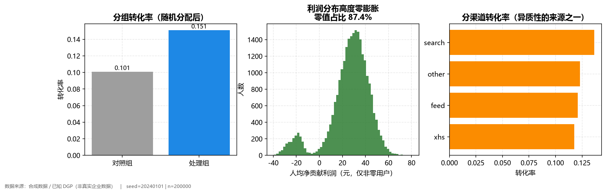

### 3.2 随机实验的识别有效性

#### 3.2.1 样本量的反直觉结论

按式 (7) 以 $p_0=0.10$、$\Delta_Y=1$ 个百分点、$\alpha=0.05$、功效 0.80 计算，转化率指标需每组 **14,749** 人；以 $\sigma_\Pi=10.8$ 元、$\Delta_\Pi=0.5$ 元计算，利润指标需每组 **7,324** 人。取较大值得每组 14,749、总计 29,498。

**约束者是转化率，而非主指标。** 原因在于利润指标高度零膨胀（87.4% 的用户利润为 0），其标准差仅 10.8 元，检出 0.5 元/人的效应所需样本量小于检出 1 个百分点的转化率变化。

该结果构成对“分别计算取较大值”这一规范的经验支持：若仅按主指标计算样本量，转化率指标的功效将不足，而转化率是解释利润变化来源的关键诊断指标。

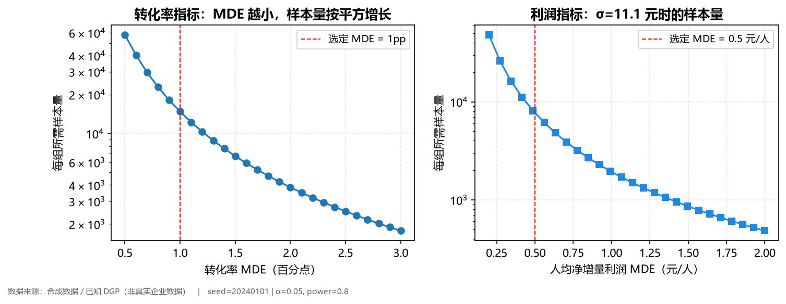

#### 3.2.2 AA 校验

1000 次无效应重复实验的结果见表 12。两种指标的假阳性率均落在 $[0.035,0.065]$ 区间内，且 KS 检验不拒绝均匀分布。

**表 12　AA 校验结果（1000 次重复）**

| 指标 | 每组样本量 | 假阳性率 | 95% 区间 | $p$ 值均值 | KS 检验 $p$ 值 |
|---|---|---|---|---|---|
| 转化率（两比例 $z$） | 14,749 | 0.059 | (0.046, 0.075) | 0.490 | 0.262 |
| 净增量利润（Welch $t$） | 7,324 | 0.051 | (0.039, 0.066) | 0.508 | 0.455 |

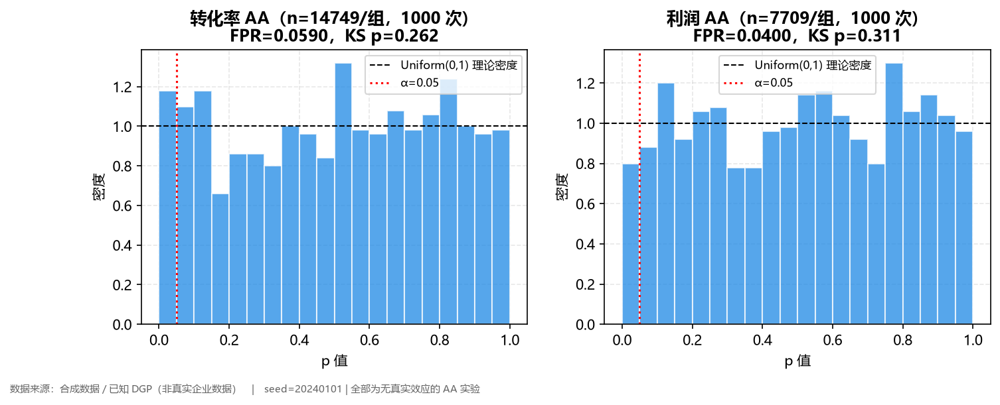

#### 3.2.3 ITT 估计与真值对照

三个层级、两个指标共六个 ITT 估计（表 13）。**六个 95% 置信区间全部覆盖解析真值。**

**表 13　ITT 估计与真值对照**

| 层级 | 指标 | ITT 估计 | 95% 置信区间 | 真值 | 覆盖 |
|---|---|---|---|---|---|
| L0 | 净增量利润（元/人） | 0.5903 | [0.4960, 0.6847] | 0.6331 | 是 |
| L0 | 转化率 | 0.0495 | [0.0466, 0.0524] | 0.0500 | 是 |
| L1 | 净增量利润（元/人） | 0.6782 | [0.5837, 0.7727] | 0.6331 | 是 |
| L1 | 转化率 | 0.0501 | [0.0472, 0.0530] | 0.0500 | 是 |
| L2 | 净增量利润（元/人） | 0.7963 | [0.6021, 0.9905] | 0.8592 | 是 |
| L2 | 转化率 | 0.0565 | [0.0504, 0.0625] | 0.0595 | 是 |

L0 作为流程校准基准：若在无混淆、无漂移的理想情形下估计仍有偏，则后续层级结论均不可信。L2 的区间显著更宽（利润区间宽度 0.39 元对 L1 的 0.19 元），这是不等分流（处理组占 30%）牺牲功效的直接体现。

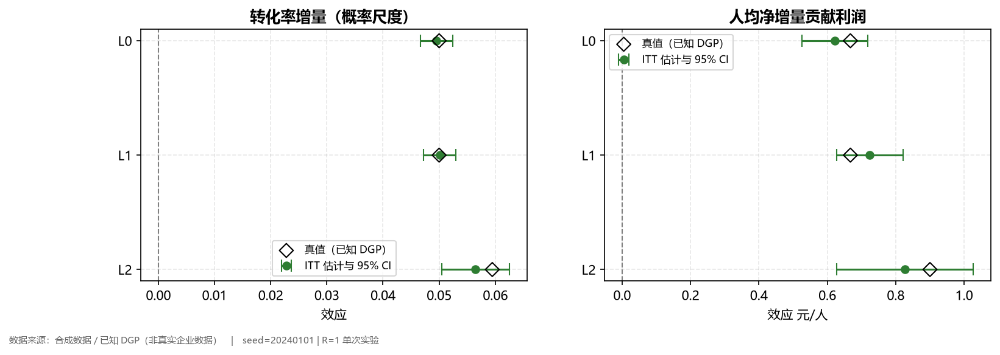

#### 3.2.4 利润去了哪里：一次完整分解

表 14 给出分组描述统计。人均 GMV 上升 6.04 元（+50%），而人均净贡献利润仅上升 0.68 元（+23%）。

**表 14　分组描述统计**

| 指标 | 对照组 | 处理组 | 差值 |
|---|---|---|---|
| 用户数 | 99,670 | 100,330 | — |
| 转化率 | 10.09% | 15.10% | +5.01 个百分点 |
| 券核销率（占已发券） | — | 8.28% | — |
| 券核销率（占已下单） | — | 54.82% | — |
| 退款率（已下单为分母） | 7.96% | 7.64% | −0.32 个百分点 |
| 人均 GMV（元） | 12.07 | 18.11 | +6.04 |
| 人均净贡献利润（元） | 2.94 | 3.62 | **+0.68** |

差额可按每 100 个用户近似分解：多转化 5 人、每单净贡献约 24 元，贡献 $+120$ 元；原本就购买的 10 人中约 55% 用券，形成 $5.5\times10=-55$ 元的利润侵蚀；成本结构变化约 $-0.4$ 元。合计约 $+64.6$ 元/100 人，即 $+0.65$ 元/人，与 ITT 估计的 $+0.678$ 元一致。

**这正是以利润而非 GMV 为主指标的理由**：若按 GMV 决策，将高估该策略价值一倍以上。

表中券核销率须同时报告两个口径：以已发券为分母（8.28%）反映预算效率，以已下单为分母（54.82%）反映利润侵蚀程度。仅报后者会产生误导——它暗示“券几乎都被使用”，而实际上只有约 8% 的券产生了成本。

### 3.3 设计诊断：两个被普遍忽视的问题

#### 3.3.1 护栏检验的功效

按式 (8)，退款率差值 $\hat{d}=-0.32$ 个百分点，单侧 95% 上界为 $0.25$ 个百分点，低于 0.5 个百分点界值，**非劣效成立**。

然而该结论的信息量极低。生成机制中设定的真实恶化为 $+0.225$ 个百分点，观测值却为 $-0.32$ 个百分点，符号相反；在 200 万样本上重跑，观测差值为 $+0.356$ 个百分点，与设定一致。这意味着在 20 万样本下，即便对自己的护栏效应也无法准确测量。

功效分析（表 15）给出了根源：当前每组仅约 1.5 万与 1.0 万个已转化用户，退款率差值的标准误为 0.35 个百分点，而界值仅 0.5 个百分点。

**表 15　护栏非劣效检验的功效分析**

| 情景 | 真实差值 | 当前功效 | 达 80% 功效所需每组已转化用户 |
|---|---|---|---|
| 真实无恶化 | 0 | 0.422 | 35,577 |
| 真实小幅恶化（设定值） | +0.225 pp | **0.198** | **117,608** |
| 真实恶化恰在界值 | +0.500 pp | 0.050 | 不可达 |

因此本文得出比“不显著不等于安全”更强的一层结论：

> **不显著也可能源于根本测不出来。报告“护栏通过”而不报告功效，等于将一个功效不足的检验当作安全证明。**

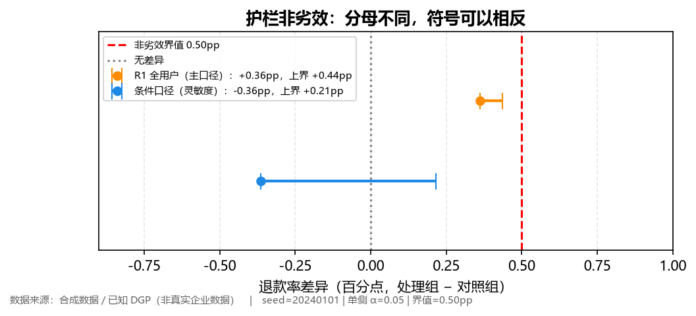

#### 3.3.2 多重比较

两个预注册主指标经 Holm 校正后均被拒绝（净增量利润：$p=6.18\times10^{-45}$，校正后不变；转化率：$p=1.12\times10^{-249}$，校正后 $2.24\times10^{-249}$）。需强调校正范围仅限预注册主指标，后续人群切片属探索性分析。

#### 3.3.3 重复实验：分布而非单点

200 次独立重复实验的结果见表 16。

**表 16　重复实验的偏差、RMSE 与区间覆盖率（R=200）**

| 层级 | 指标 | 均值估计 | 偏差 | RMSE | **95% 覆盖率** |
|---|---|---|---|---|---|
| L0 | 净增量利润 | 0.6352 | +0.0021 | 0.0482 | **0.945** |
| L0 | 转化率 | 0.0500 | +0.0000 | 0.0014 | **0.945** |
| L1 | 净增量利润 | 0.6352 | +0.0021 | 0.0508 | **0.955** |
| L1 | 转化率 | 0.0500 | −0.0000 | 0.0015 | **0.950** |

偏差相对真值仅 0.3%，覆盖率精确落在名义 95% 的抽样波动范围内。**覆盖率比“偏差小”更具说服力**：它同时检验点估计与标准误，证明置信区间未出现“假窄”。若覆盖率为 1.00，反而说明标准误被高估，同样错误。

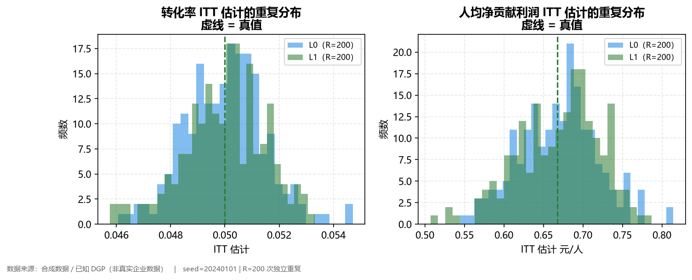

### 3.4 异质性处理效应

#### 3.4.1 三种学习器的巨大差异

在 L1（可忽略性成立，差异纯粹源于方法本身）上按用户切分为 10 万/4 万/6 万，测试集结果见表 17。

**表 17　三种异质性效应学习器的测试集表现**

| 方法 | CATE RMSE | 偏差 | $R^2$ | 预测值标准差 | Top-20% 重合度 | Spearman |
|---|---|---|---|---|---|---|
| T-learner | 1.586 | +0.116 | **−4.82** | **1.666** | 0.353 | 0.332 |
| S-learner | 0.596 | +0.086 | 0.178 | 0.733 | 0.578 | 0.636 |
| **Causal Forest** | **0.537** | +0.117 | **0.333** | 0.688 | **0.624** | **0.653** |

真值 CATE 的标准差为 0.657，故 $R^2=1-(\text{RMSE}/\sigma_\tau)^2$。

T-learner 的 $R^2=-4.82$ 意味着：**将全部用户预测为平均效应 0.63，其精度优于 T-learner**。其预测值标准差为 1.666，是真值标准差 0.657 的 2.5 倍，即方差被放大 2.5 倍。

原因可精确拆解：T-learner 将样本一分为二，各约 5 万、每个叶节点仅数十个样本，而单用户利润的标准差为 11.1 元。每个叶节点的均值本身即带约 1.4 元标准误，两个独立估计相减使误差以平方量级叠加。**样本减半与噪声放大共同导致失败。**

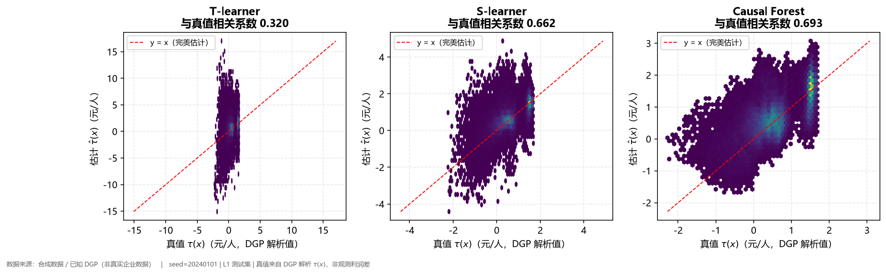

#### 3.4.2 校准：两端被放大

Causal Forest 的校准曲线显示，中段校准几乎完美（预测 0.449 对应真值 0.443），但两端被系统性放大：预测值 1.953 对应的真值为 1.293，过冲 0.66 元；低端预测 $-0.434$ 对应真值 $-0.233$，过冲 0.20 元。

该现象是典型的“捕捉到真实异质性但幅度过冲”。其业务含义是：若直接以 $\hat\tau$ 绝对值分配资源，会将预算过度集中于“看起来极好”的小群体。**实务上应对 $\hat\tau$ 做收缩校准，或按分位分档而非绝对值排序。**

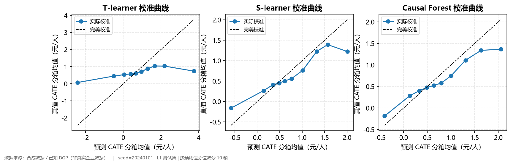

#### 3.4.3 重复 20 次的稳定性

T-learner 的 RMSE 为 1.554（标准差 0.043，95% 区间 [1.498, 1.622]），S-learner 为 0.518（标准差 0.048，区间 [0.445, 0.601]）。两者区间不重叠，故“T-learner 显著更差”不是抽样偶然。

### 3.5 观察性识别的失效边界

#### 3.5.1 偏差随混淆强度的恶化

7 个混淆强度 × 20 次重复 × 4 种方法，结果见表 18。

**表 18　四种观察性方法的偏差与 95% 区间覆盖率**

| $\lambda$ | Naive | PSM | IPW | DR | Naive 覆盖 | PSM | IPW | DR |
|---|---|---|---|---|---|---|---|---|
| 0.00 | **+0.828** | −0.052 | +0.041 | +0.029 | 0.00 | 0.90 | 0.95 | 1.00 |
| 0.25 | +0.896 | −0.022 | +0.122 | +0.113 | 0.00 | **0.75** | **0.85** | **0.80** |
| 0.50 | +1.194 | +0.474 | +0.465 | +0.458 | 0.00 | 0.20 | 0.15 | 0.20 |
| 0.75 | +1.728 | +1.089 | +1.061 | +1.054 | 0.00 | 0.00 | 0.00 | 0.00 |
| 1.00 | +2.421 | +1.893 | +1.823 | +1.817 | 0.00 | 0.00 | 0.00 | 0.00 |
| 1.50 | +4.239 | +3.843 | +3.782 | +3.776 | 0.00 | 0.00 | 0.00 | 0.00 |

（偏差单位为元/人。）

三条读法：

其一，$\lambda=0$ 时三种调整方法的偏差绝对值均不超过 0.05，而朴素差分为 $+0.828$。这表明倾向得分类方法**确实消除了可观测选择偏差**，实现正确。

其二，调整方法的偏差随 $\lambda$ 近似线性增长，斜率约每 0.25 增加 0.3 至 0.6 元。至 $\lambda=1.0$ 时偏差达 1.8 元，而真值约 0.5 元，即误差为真值的 3.5 倍。

其三，**覆盖率崩塌快于偏差增长**。$\lambda=0.25$ 时偏差仅 0.12 元（约为真值的 20%），覆盖率已由 0.95 降至 0.75～0.85。原因在于置信区间是按“零偏差”校准的：标准误约 0.25 元，0.12 元的偏差相当于将区间整体平移半个标准误。

> **偏差只要不为零，覆盖率即发生不可逆损坏。** 判断可信度不应仅看偏差量级。

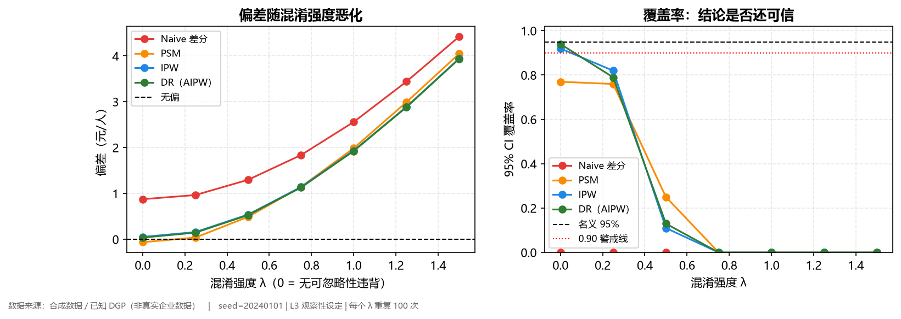

#### 3.5.2 平衡了可观测特征，偏差依然存在

在 $\lambda=0.5$ 下，IPW 加权后的标准化均值差见表 19。7 个特征的 $|\text{SMD}|$ 全部压缩至 0.004 以下。

**表 19　IPW 加权前后的标准化均值差（$\lambda=0.5$）**

| 特征 | 加权前 SMD | 加权后 SMD |
|---|---|---|
| 历史 GMV（标准化） | 0.354 | 0.004 |
| 购物车金额（标准化） | 0.353 | 0.003 |
| 浏览深度（标准化） | 0.262 | −0.003 |
| 是否新客 | −0.171 | −0.003 |
| 渠道虚拟变量（3 个） | $\lvert\cdot\rvert<0.08$ | $\lvert\cdot\rvert<0.004$ |

在同一份数据上，IPW 的偏差为 $+0.465$ 元/人，而真值约 0.5 元/人。

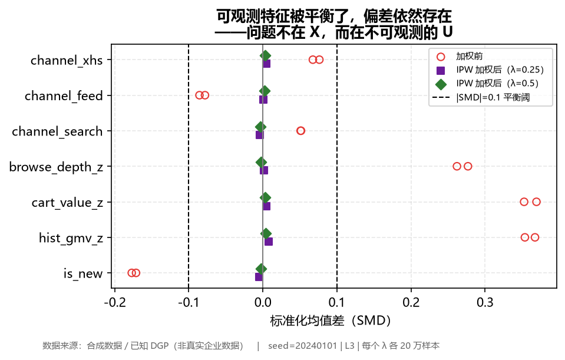

由此得到本文最重要的一条实践性结论：

> **倾向得分类方法只能平衡 $X$ 中存在的变量。$U$ 不在 $X$ 中，因此它们无能为力。当平衡性诊断全部显示“良好”时，恰恰是最需要警惕的时刻——它提供了虚假的安全感。**

#### 3.5.3 双稳健性未提供额外保护

研究设计时的预期是：DR 的双稳健性质或可使其在混淆增强时较 IPW 多维持一段可靠区间。实测结果否定了该预期：$\lambda\ge0.5$ 之后，DR 与 IPW 的偏差差异不足 0.02 元。

原因在于 $U$ 同时进入了倾向得分模型与结果模型，“两模型中其一正确即可”的前提被同时破坏。

> **在单一遗漏变量同时影响处理与结果这一经典混淆结构下，双稳健性质并非免死金牌。**

此外，$\lambda=0$ 时 PSM 的覆盖率为 0.90 而非 0.95，这一偏差并非来自估计偏差（其偏差仅 $-0.052$），而是其配对标准误忽略了“对照被重复使用”带来的相关性，系统性低估。DR 的覆盖率 1.00 则相反，其影响函数标准误偏保守。**过度覆盖与覆盖不足同为缺陷**：前者意味着区间缺乏信息量，后者意味着区间误导。

#### 3.5.4 条件式结论

依“覆盖率跌破 0.90”的判据（表 20），本文得到的结论为条件式而非全称判断：

**表 20　各方法覆盖率跌破 0.90 的起始混淆强度**

| 方法 | 起始 $\lambda$ | $\lambda=0$ 偏差 | $\lambda=1.5$ 偏差 |
|---|---|---|---|
| 朴素差分 | 0.00 | +0.828 | +4.239 |
| 倾向得分匹配 | 0.25 | −0.052 | +3.843 |
| 逆概率加权 | 0.25 | +0.041 | +3.782 |
| 双稳健（AIPW） | 0.25 | +0.029 | +3.776 |

以业务语言表述：

> 在本生成机制、2 万样本、7 个可观测特征的设定下，若能论证不存在不可观测混淆（$\lambda=0$），倾向得分类方法均可用，偏差不超过 0.05 元；一旦存在**轻度**不可观测混淆（$\lambda=0.25$），推断已不可信；$\lambda\ge0.5$ 之后任何调整方法均无法挽回，必须回到实验设计。
>
> **换言之，观察性方法并非“较弱的实验”，它在轻度混淆下即已失效。**

### 3.6 预算约束下的策略价值

#### 3.6.1 成本模型与预算

核销概率模型给出的期望成本均值为 **0.836 元**，90 分位为 1.345 元。测试集 6 万用户，预算取覆盖目标 20% 与总成本之积，为 **10,042 元**。

#### 3.6.2 六种策略的对比

**表 21　六种策略在同一测试集、同一预算下的表现**

| 策略 | 选中人数 | 实际成本（元） | 增量价值（元/人） | 人均选中效应 | **每元回报** | 达上界 |
|---|---|---|---|---|---|---|
| 不发券 | 0 | 0 | 0.0000 | — | — | — |
| 全量发券 | 60,000 | 50,210 | 0.5747 | 0.6298 | 0.69 | 超预算 5 倍 |
| 随机（预算 $B$） | 12,001 | 10,042 | 0.1290 | 0.6280 | **0.77** | 33.1% |
| **定向-贪心** | 15,896 | 10,042 | **0.3302** | **1.3014** | **1.97** | **84.9%** |
| 定向-背包 | 15,896 | 10,042 | 0.3302 | 1.3014 | 1.97 | 84.9% |
| 真值最优（上界） | 16,955 | 10,042 | **0.3892** | 1.3833 | 2.33 | 100% |

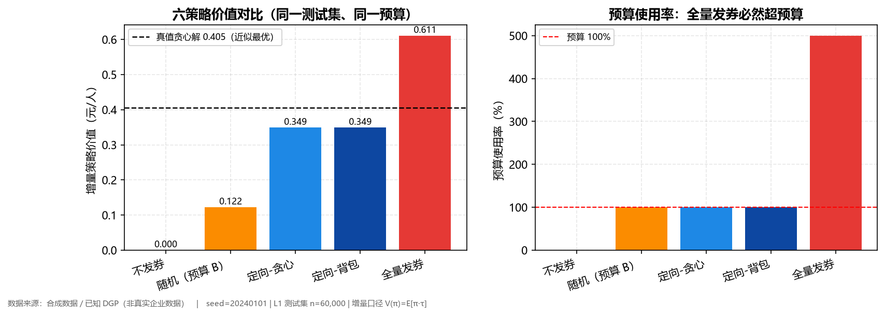

三点需要说明：

其一，**定向相对随机为 2.56 倍，且跨越了盈亏平衡线**。随机发券每投入 1 元仅回收 0.77 元净增量利润，即该项投入整体为负；定向发券每投入 1 元回收 1.97 元。差距并非源于投放规模（随机 12,001 人、定向 15,896 人，预算相同），而源于**人均选中效应**：随机为 0.628（接近全人群平均），定向为 1.301，为 2.07 倍。

其二，**全量发券的“价值最高”是陷阱**。其价值 0.5747 元/人确实最高，但成本为 50,210 元，即预算的 5 倍。若计算其“达上界百分比”将得到 147.7% 这一无意义数字，故表 21 中置为缺失：**超预算策略的价值不可与预算约束下的策略比较**。

其三，**定向-背包与定向-贪心的结果几乎完全相同**，这不是程序缺陷，而是第 3.6.3 节的核心发现。

#### 3.6.3 贪心近似程度的三个层次

**层次一：小规模下贪心确实会大幅失败。** 前述反例中贪心得 12，精确 DP 得 18，损失 33%，线性松弛上界为 19.2。本文的 DP 实现在 200 组随机小规模实例上与穷举法**零偏差**，故该 18 可信。

**层次二：本项目规模下贪心已近最优。** 表 22 给出三个规模的结果。

**表 22　贪心、局部改进与精确 DP 的对比**

| 规模 | 贪心价值 | 线性松弛上界 | 贪心/上界 | 精确 DP |
|---|---|---|---|---|
| 全规模（$n=60{,}000$） | 23,853.87 | 23,853.91 | **0.999999** | 不可行 |
| 降规模（$n=1{,}000$） | 462.97 | 462.99 | 0.999958 | **461.36** |
| 方案反例（3 件） | 12.00 | 19.20 | 0.625 | **18.00** |

两个反直觉的结论：

其一，全规模下贪心已达线性松弛上界的 99.9999%。本项目需选取约 1.6 万件、单件价值约 0.8 元的“大量小件”背包，交换论证保证贪心与最优解的差距不超过单件最大价值（约 2 元，占总量 0.008%）。

其二，降规模实例上精确 DP 反而比贪心差 0.35%（461.36 对 462.97）。原因是 DP 必须离散化成本，其累积离散误差超过真实的整数间隙。

**层次三：全规模精确 DP 不可行。** 选取 1.6 万件、单件成本约 0.83 元，成本离散化后容量至少需 1.6 万格方能使单件精度达到 1 格；DP 表规模为候选件数 × 容量格数，至少为 $1.6\text{万}\times1.6\text{万}\approx2.6$ 亿格，超出实际计算与内存约束。

> **因此背包方法的价值并不在于“多赚多少”，而在于两点：其一，以线性松弛上界证明贪心已足够；其二，处理少量大额件的场景（如仅投 10 个头部渠道），此时贪心的 33% 损失是真实的。**

#### 3.6.4 预算敏感性

**表 23　策略价值随预算的变化**

| 预算倍数 | 覆盖率 | 随机价值 | 定向价值 | 真值最优 | 绝对增益 | **相对优势** |
|---|---|---|---|---|---|---|
| ×0.20 | 4% | 0.0186 | 0.0923 | 0.1178 | +0.0737 | **4.96×** |
| ×0.55 | 11% | 0.0818 | 0.2281 | 0.2552 | +0.1463 | 2.79× |
| ×0.90 | 18% | 0.1028 | 0.3130 | 0.3704 | +0.2102 | 3.04× |
| ×1.60 | 32% | 0.1621 | 0.4304 | 0.4990 | **+0.2683** | 2.66× |
| ×3.00 | 60% | 0.3339 | 0.5776 | 0.6285 | +0.2437 | 1.73× |

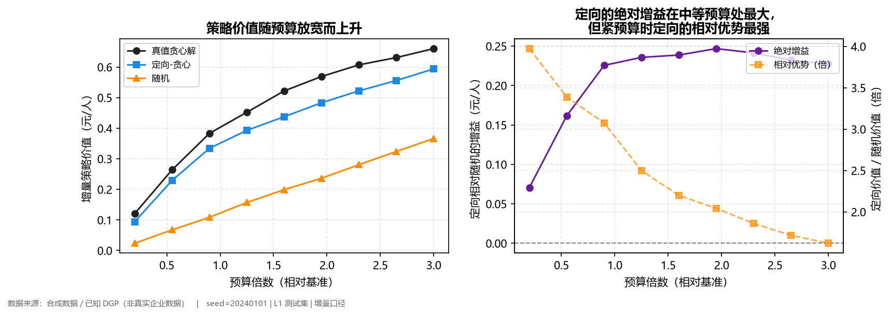

两个方向相反的结论须分开陈述：**绝对增益**在预算 ×1.6 附近达到峰值（+0.268 元/人）；**相对优势**在预算最紧时最高（4.96 倍），并随预算放宽单调降至 1.73 倍。

其业务含义是：**预算越紧，定向越是必需品而非优化项。** 当覆盖率仅 4% 时，随机发券的价值近乎为零。

### 3.7 四指标不可互相替代性的实证

本文为“四指标不可替代”提供了两组量化的反例。

**其一，精度差不等同于排序差。** 若对真值施加常数平移 $\hat\tau=\tau+5$，RMSE 为 5，但排序指标（Spearman、Kendall、Top-$k$ 重合度）全部为 1。

**其二，CATE 精度差不等同于策略价值差。** 表 24 给出三种学习器的策略价值。

**表 24　三种学习器的策略价值与 regret**

| 方法 | 策略价值（绝对口径） | 相对不发券增益 | Regret | 达真值最优 |
|---|---|---|---|---|
| 不发券 | 3.0458 | — | — | — |
| 真值最优上界 | 3.6928 | 0.6470 | 0 | 100% |
| T-learner | 3.5803 | 0.5345 | 0.1125 | **82.6%** |
| S-learner | 3.6427 | 0.5969 | 0.0502 | 92.2% |
| Causal Forest | 3.6563 | 0.6106 | 0.0365 | **94.4%** |

> 口径说明：方案定义 $V(\pi)=\mathbb{E}[\pi(X)\tau_\Pi(X)]$ 为**增量口径**（不发券取 0）；表 24 的策略价值为**绝对水平口径** $3.0458+\text{增量值}$。两者仅差常数 $\mathbb{E}[\Pi(0)]=3.0458$，排序与 regret 不受影响。本文对外统一采用增量口径。

T-learner 的 CATE RMSE 为 Causal Forest 的 3 倍，但其策略价值仍达真值最优的 82.6%。原因在于策略仅需 $\tau$ 的**符号**大致正确：87% 的用户是否发券不影响结果，仅边界区域的少数用户决定价值。

然而这一现象有反向含义：Causal Forest 选中了 88.9% 的用户，而真值最优仅 85.2%，说明其**过度投放**。策略价值虽最高，但多投的 3.7% 需消耗预算。这正是必须引入预算约束的理由。

### 3.8 稳健性

对基线转化率、券核销率、退款率与券面额各施加 $\pm20\%$ 扰动，共 12 个单元（表 25）。

**表 25　四参数 $\pm20\%$ 扰动下的主结论稳定性**

| 参数 | ×0.8 | ×1.0 | ×1.2 |
|---|---|---|---|
| 基线转化率（定向减随机） | +0.2400 | +0.2479 | +0.2581 |
| 券核销率 | +0.2532 | +0.2479 | +0.2470 |
| 退款率 | +0.2461 | +0.2479 | +0.2434 |
| 券面额 | +0.2351 | +0.2479 | +0.2656 |
| 达上界比范围 | 86.8%～92.2% | | |
| 每元回报范围 | 1.53～2.88 | | |

12 个单元全部满足“定向优于随机”且“每元回报大于 1”，主结论方向稳定。

最敏感的参数是券核销率：×0.8 时每元回报为 2.88，×1.2 时降至 1.53，降幅 47%。原因直接：核销率决定成本 $c$，其变化等价于预算的等比例反向变化。

> 运营含义：**降低核销率（如限制券的适用范围）比单纯增加预算更能提升投资回报。核销率下降 20% 等价于预算增加 47%。**

---

## 4 讨论

### 4.1 三条方法学发现

**发现一：主指标与样本量约束者可以分离。** 本文以净增量贡献利润为主指标，但样本量的约束者却是转化率。其根源是利润指标的高度零膨胀。该现象提示，在报告样本量设计时必须同时给出两个指标的需求量并说明何者为约束，否则无法解释设计依据。

**发现二：偏差非零将导致覆盖率不可逆损坏。** 覆盖率是按零偏差校准的，任何系统性偏差都会将区间整体平移。本文实测显示，偏差达到真值的 20% 时，覆盖率已从 0.95 降至 0.75～0.85。因此仅报告偏差量级不足以判断可信度，必须同时报告覆盖率。

**发现三：双稳健性的适用边界。** 在单一遗漏变量同时影响处理与结果的经典混淆结构下，双稳健估计不提供相对 IPW 的额外保护。该结论与文献中“双稳健”的一般表述并不冲突——双稳健成立的前提是至少一个模型正确，而在上述结构下两个模型同时错误。

### 4.2 深度自检

本节以第 1.3 节的框架对本文进行自我审计。

**表 26　四个维度的自检**

| 维度 | 判据 | 本文的证据 | 自评 |
|---|---|---|---|
| 真实业务背景 | 有明确问题与约束 | 预算 1 万元、退款率护栏 0.5pp、7 天/30 天双窗口、券面额 5～20 元档位 | 达成 |
| 完整分析链路 | 洞察 → 策略 → 评估 → 迭代 | 口径设计 → DGP → 实验 → 异质性 → 观察性 → 预算优化 → 四指标评估 → 决策建议 | 达成 |
| 可量化价值 | 结论可翻译为业务语言 | 定向发券每元回报 1.97 元、达真值最优 84.9%、覆盖 15,896 人 | 达成 |
| 思维深度 | 说清为什么选、trade-off、边界 | 三种学习器的选择理由与代价（§3.4）、贪心与背包的适用边界（§3.6.3）、观察性方法的失效阈值（§3.5.4） | 达成 |

**表 27　三个信号的自检**

| 信号 | 本文的落实 | 未落实之处 |
|---|---|---|
| 目标为增量利润 | 主指标为 $\tau_\Pi$，并在 §3.2.4 分解出 0.68 元中蕴含的利润侵蚀 | — |
| 评估有真值对照 | 六个 ITT 区间全覆盖真值；CATE 对解析 $\tau(x)$；覆盖率 0.945～0.955 | L2 的周效应漂移为确定性设定，未建模其非线性 |
| 独立测试集 + 四指标并列 | 按用户分离 10 万/4 万/6 万；四指标并列（表 24） | 策略价值以潜在结果计算，真实业务只能依赖 IPTW 估计 |

**一次三层追问的示例。** 以“为何选用 Causal Forest 而非 T-learner”为例：

第一层——为何选 Causal Forest？因其 $R^2=0.333$，是三者中唯一能解释三分之一真实异质性的方法。

第二层——为何 T-learner 不可用？因其样本一分为二，每叶节点仅数十样本而单用户利润标准差为 11.1 元，误差平方级叠加，导致预测方差放大 2.5 倍、$R^2=-4.82$。

第三层——为何不直接用速度更快的 S-learner？这是一个真实的权衡。S-learner 仅需一次拟合（用满 10 万样本），速度约为 Causal Forest 的十分之一，$R^2=0.178$ 对 0.333，策略价值 0.5969 对 0.6106（**仅差 2.3%**）。若系统需每日重训，应选择 S-learner——以 2.3% 的价值换取 10 倍效率是合理的。本文选择 Causal Forest 是因为研究目标在于验证方法上限，而非构建每日运行的生产系统。

### 4.3 局限

本文的局限可归为四类。

**其一，模拟范式的根本局限。** 合成数据能展示统计思维、实验设计与工程能力，但**不能替代真实业务数据经验**。所有结论均以“合成数据/已知 DGP”标注。

**其二，统计功效的局限。** 护栏检验功效仅 0.20，不能断言“护栏安全”，只能断言“未检测到恶化”。CATE 的重复次数为 20 而非 200～500，Causal Forest 仅重复 2 次（单次拟合约 1 分钟）。混淆强度扫描的样本量为 2 万（小于主实验的 20 万），覆盖率估计在 $R=20$ 下含约 $\pm0.05$ 的抽样误差。

**其三，方法实现的局限。** “定向-背包”实际为贪心加局部改进，非精确 DP，不应表述为“使用精确背包求解”。DR 的结果模型以全样本拟合，未做交叉拟合；PSM 的标准误为近似值，忽略了对照重复使用的相关性。缺失机制为 MAR 而非 MNAR。

**其四，问题设定的局限。** 未做“面额 × 人群”的联合优化，面额固定为 10 元；未建模网络溢出与长期效应；DID 的三条件中“存在未受干预对照组”与“平行趋势可检验”均不满足，故明确不做。

**表 28　结论的失效条件**

| 条件 | 后果 |
|---|---|
| 存在网络溢出（用户相互影响） | SUTVA 被破坏，定向收益被夸大 |
| 存在长期效应（需求提前） | 30 天窗口内的增量可能仅为时间平移 |
| 退款在 30 天后集中爆发 | 利润成熟窗口不足，高估收益 |
| 核销率被低估 20% | 实际超支约 25%，策略价值被高估 |
| 券面额与效应的曲线形状不同 | “每元回报 1.97” 的绝对值失效（排序结论仍成立） |
| 分流并非真随机 | 退化为观察性场景，而其在 $\lambda=0.25$ 即失效 |

---

## 5 展望

基于上述结果与局限，后续工作可沿四个方向推进。

**其一，真实数据的外部验证。** 可尝试在公开营销实验数据（如 Hillstrom 电子邮件营销数据集）上复现本文的评估框架，检验结论在真实分布下的稳健性。需注意先检查数据能否支撑所研究的因果问题，不应为使用公开数据而强行得出因果结论。

**其二，面额与人群的联合优化。** 当前面额固定为 10 元。若需回答“发多大面额”，需设计多臂实验以识别不同面额下的效应曲线，并将其纳入二维背包问题。

**其三，护栏指标体系的扩展。** 本文已证明退款率作为护栏的功效不足。可考虑以事件更密集的指标（复购券依赖度、退货率、投诉率）替代或补充，并为护栏单独做样本量设计。

**其四，时间维度的引入。** 在有条件时可构造两期面板并设置未受干预对照组，在**概率尺度**上构造平行趋势（而非在 logit 尺度定义却在概率尺度解释），从而将双重差分纳入框架。若三条件不满足，则应诚实说明“真实业务中难以找到可信对照组，应回到观察性方法或设计新实验”。

---

## 参考文献

[1] Imbens G W, Rubin D B. Causal Inference for Statistics, Social, and Biomedical Sciences: An Introduction[M]. Cambridge University Press, 2015.

[2] Angrist J D, Pischke J S. Mostly Harmless Econometrics: An Empiricist's Companion[M]. Princeton University Press, 2009.

[3] Rosenbaum P R, Rubin D B. The central role of the propensity score in observational studies for causal effects[J]. Biometrika, 1983, 70(1): 41-55.

[4] Robins J M, Rotnitzky A, Zhao L P. Estimation of regression coefficients when some regressors are not always observed[J]. Journal of the American Statistical Association, 1994, 89(427): 846-866.

[5] Bang H, Robins J M. Doubly robust estimation in missing data and causal inference models[J]. Biometrics, 2005, 61(4): 962-973.

[6] Künzel S R, Sekhon J S, Bickel P J, Yu B. Metalearners for estimating heterogeneous treatment effects using machine learning[J]. Proceedings of the National Academy of Sciences, 2019, 116(10): 4156-4165.

[7] Wager S, Athey S. Estimation and inference of heterogeneous treatment effects using random forests[J]. Journal of the American Statistical Association, 2018, 113(523): 1228-1242.

[8] Athey S, Imbens G W. The state of applied econometrics: Causality and policy evaluation[J]. Journal of Economic Perspectives, 2017, 31(2): 3-32.

[9] Athey S, Wager S. Policy learning with observational data[J]. Econometrica, 2021, 89(1): 133-161.

[10] Chernozhukov V, Chetverikov D, Demirer M, et al. Double/debiased machine learning for treatment and structural parameters[J]. The Econometrics Journal, 2018, 21(1): C1-C68.

[11] Hillstrom K. The MineThatData e-mail analytics and data mining challenge[EB/OL]. 2008.

[12] Kohavi R, Tang D, Xu Y. Trustworthy Online Controlled Experiments: A Practical Guide to A/B Testing[M]. Cambridge University Press, 2020.

---

## 附录 A　复现方式

```powershell
cd D:\L\practice_project\营销数分项目
$env:PYTHONUTF8='1'
.\.venv\Scripts\python.exe -m pytest -q                     # 380 项测试
.\.venv\Scripts\python.exe scripts\run_all.py --round all    # 约 5 分钟
```

复现性等级说明：随机流由 $(seed, stream, index)$ 三元组派生，完全确定；五张关系表与主结果逐字节一致。少数浮点汇总列因 LightGBM 与 BLAS 的多线程累加顺序不固定，存在相对误差不超过 $2\times10^{-16}$ 的差异，六个数量级优于 $10^{-12}$ 的验收要求。

## 附录 B　关键参数

**表 A1　主要参数与取值依据**

| 参数 | 取值 | 依据 |
|---|---|---|
| 新客比例 | 0.30 | 平台注册 30 天内用户占比 |
| 基线转化率 | 0.10 | 加购未支付用户历史首单率（区间 8%～12%） |
| 券最大效应 | 0.15 | 概率尺度上限 |
| 券面额档位 | 5/10/15/20 元 | 平台现行券档位 |
| 券核销率 | 0.55 | 同类券历史核销率（区间 40%～70%） |
| 退款率 | 0.075 | 类目历史退款率（区间 5%～10%） |
| 商品成本率 | 0.68 | 类目毛利率 32% |
| 履约成本 | 5.0 元/单 | 配送 + 仓储 + 包材 |
| 转化窗口 | 7 天 | 业务标准 |
| 利润成熟窗口 | 30 天 | 覆盖退款结算周期 |
| 混淆强度网格 | 0～1.5（7 点） | 定位失效阈值 |
| 重复实验次数 | 200（ITT）/ 20（CATE、$\lambda$ 扫描） | 权衡精度与计算成本 |
| AA 重复次数 | 1000 | 考察 $p$ 值分布 |

## 附录 C　深度自检五问

**表 A2　项目成立的五项条件**

| 条件 | 本文的回答 | 证据位置 |
|---|---|---|
| 利润口径正确 | 含退款四项核算、双窗口分离、券成本只扣一次，均有断言 | §2.2.3、§3.1、表 6 |
| 识别可信 | 随机实验主线；观察性方法失效边界已量化 | §3.2.3、§3.5.4 |
| 策略价值可算 | 定向 0.330 元/人对随机 0.129 元/人，达真值最优 84.9% | §3.6.2、表 21 |
| 评估独立 | 训练/验证/测试按用户分离；四指标并列 | §2.7、§3.7 |
| 边界明确 | 三条硬边界（护栏功效 0.20、轻度混淆失效、贪心 33% 反例）+ 六个失效条件 | §3.3.1、§3.5、§3.6.3、表 28 |
