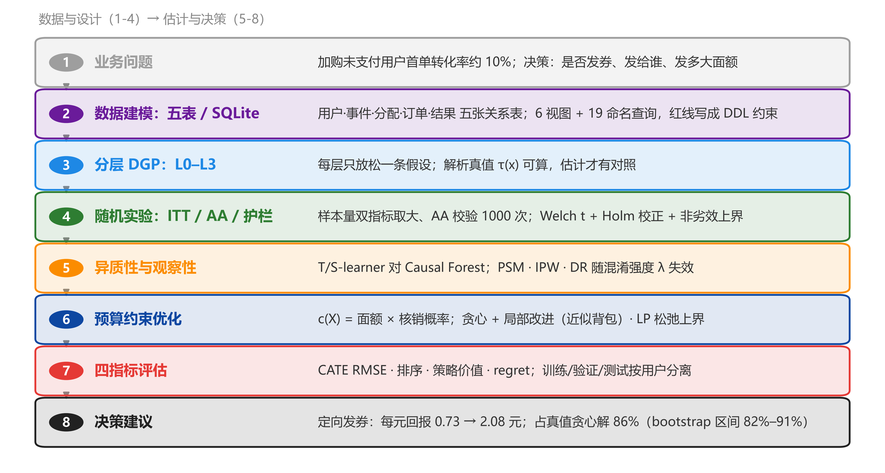
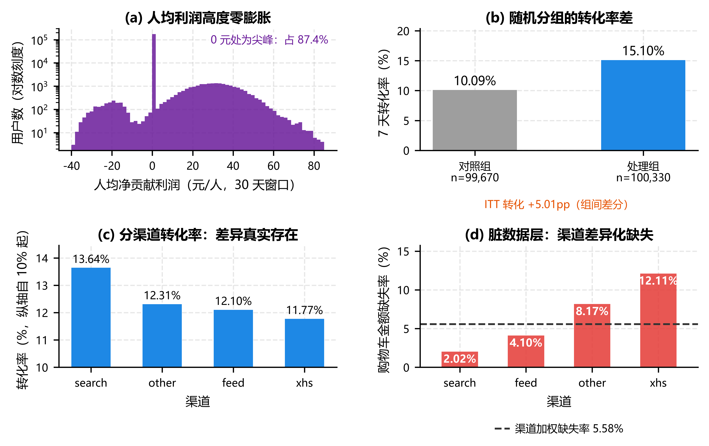
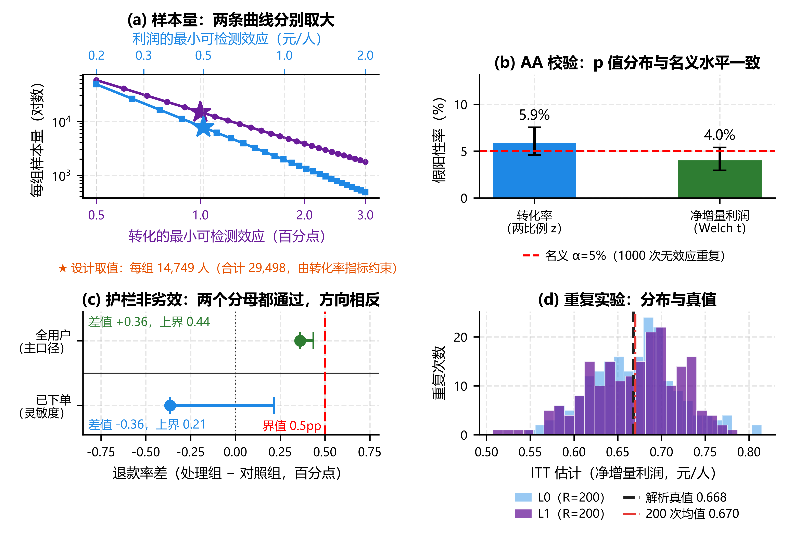
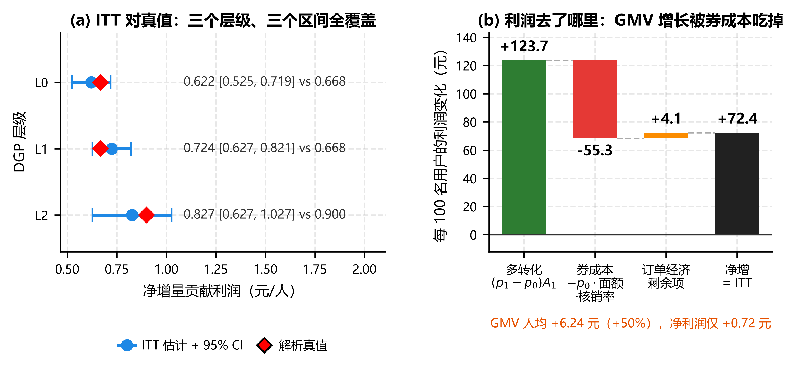
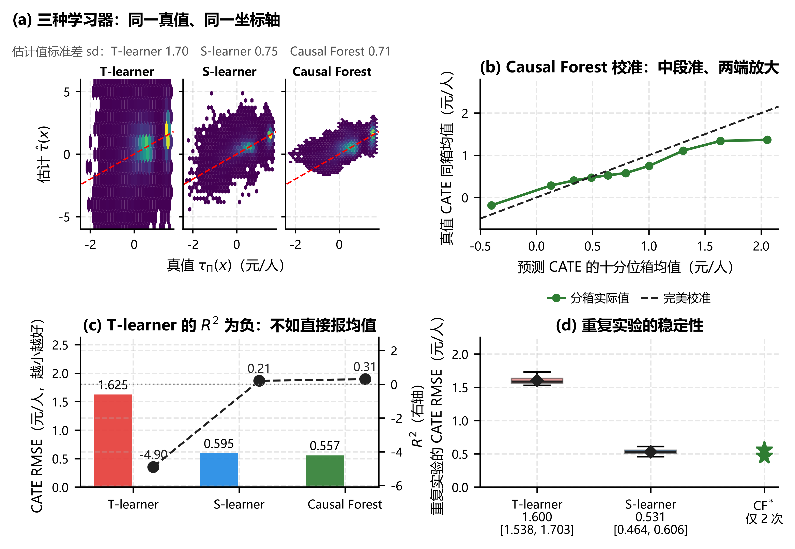
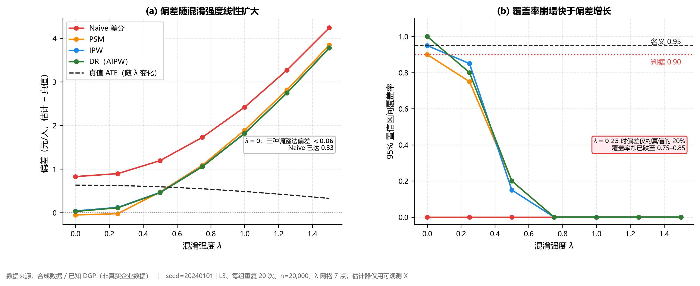
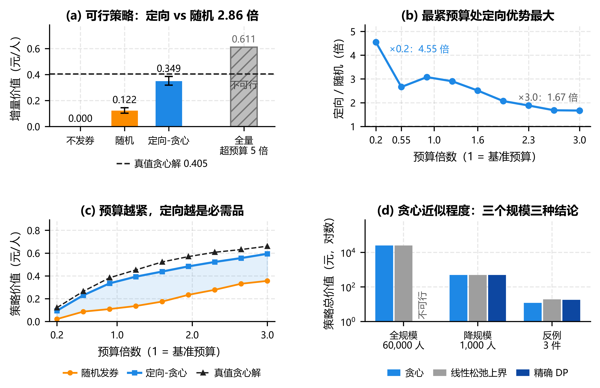

# 预算约束下电商营销策略的因果评估与增量利润优化

## 基于已知数据生成过程的模拟验证研究

---

**Lrvin**　　liliw@126.com

**摘要**

电商营销长期以转化率为目标。该指标无法区分真实增量、利润侵蚀与需求提前，也支撑不了“是否发券、发给谁、发多大面额”的组合决策。本文构建微观机制已知的分层模拟器（L0–L3），以每位合格用户的净增量贡献利润为首要指标、转化率为共同主指标，在预算与风险约束下评估营销策略的因果效应与策略价值。模拟器的真值由解析式给出，训练与测试按用户切分。方法包括随机实验（样本量双指标、AA 与 SRM 校验、ITT、护栏非劣效与 Holm 校正）、观察性识别（朴素差分、PSM、IPW、DR 随未观测混淆强度 $\lambda$ 扫描，每格重复 100 次并给 Clopper–Pearson 区间）与预算约束优化（贪心 + 局部改进（近似背包）、LP 松弛上界）。20 万用户、重复 200 次的结果是：ITT 偏差 $+0.002$ 元/人，覆盖率 0.950；定向发券人均增量利润 0.349 元（95% CI 0.318–0.384），为随机发券 0.122 元（200 个种子）的 2.9 倍，每元回报 2.08 元（95% CI 1.91–2.29），占真值贪心解 86%（95% CI 82%–91%）。边界结论有三条。样本量约束者可以不是主指标，翻转临界 0.36 元/人。护栏的分母决定结论：全用户口径差值 $+0.36$pp、单侧上界 0.435pp、功效 0.64；已下单口径差值 $-0.36$pp、上界 0.215pp、功效 0.194，“通过”必须连同分母与功效一起报。轻度混淆（$\lambda=0.25$）下 IPW/DR 覆盖率跌至 0.82/0.79，而 $\lambda=0.5$ 时标准化均值差全部低于 0.004，平衡性诊断全绿时观察性估计仍可能失效。贪心另有一处边界：全规模下与 LP 松弛上界只差 $1.8\times10^{-7}$，3 件大额件的反例中损失 33%。结果基于合成数据与已知 DGP，结论只在给定生成机制内成立。

**关键词**：因果推断；增量利润；异质性处理效应；预算约束优化；模拟验证

---

## 1 引言

### 1.1 研究背景

某电商平台“加购未支付”用户的首单转化率约 10%，运营侧持有固定预算，要决定是否发券、发给谁、发多大面额。转化率与 GMV 无法区分三种机制：真实增量、利润侵蚀与需求提前。真实增量下转化与利润同升；利润侵蚀下本会购买的用户多领了券，转化升而利润降；需求提前则是窗内升、长期为零。利润侵蚀的个体效应为负，转化率完全反映不出来。以转化率为核心的目标因此会高估营销价值[1]。

### 1.2 问题提出

由此产生三个问题。把目标换成净增量贡献利润后，“该不该发券”还能不能被无偏地回答，估计量是否有偏、区间是否校准。随机化不可行、只能使用观察数据时，常见调整方法在多大的混淆强度下开始失效，失效是渐变还是断崖，能否给出可操作的阈值。定向投放比随机发送多创造多少价值，离理论最优还差多远。最后一个差距必须能量化，否则“精准营销”只是一句口号。

### 1.3 研究目的与意义

方法上，模拟器的真值已知，偏差因此从不可观测量变成可核对的量。真值只取自数据生成过程的解析式；训练与测试按用户切分；结论写成条件式[2]。实践上要回答的是一个可执行的问题：给定预算与风险护栏，定向发券的每元回报是多少，落在多大概率区间内，在什么条件下失效。护栏、观察性调整与预算约束这三处边界的口径，是全文的重点；八个研究环节的先后关系见图 1。

{width=\linewidth}

### 1.4 研究问题与假设

- RQ1：在同样的用户与预算下，以净增量贡献利润为目标的定向策略，每元回报能否显著超过 1（即“发券赚钱”），并显著超过随机发券？
- RQ2：观察性调整（PSM、IPW、DR）在什么混淆强度下失去校准能力，失效能否用区间而非点估计判定？
- RQ3：预测精度（RMSE）、排序质量与策略价值三者能否互相替代？
- H1：利润是高度零膨胀的重尾变量，方差不足以让它成为样本量的约束者，主指标与样本量约束指标会分离。
- H2：可观测特征被完全平衡并不保证无偏，覆盖率会比偏差更早崩塌。
- H3：策略只依赖 $\tau$ 的符号与排序，RMSE 的差距不会等比例转化为策略价值的差距。

### 1.5 论文结构安排

研究按“设计、估计、评估、决策”四步推进。先确定研究对象与口径，再在分层模拟器中估计因果效应，随后比较策略价值，最后讨论边界与局限。附录给出关键参数、复现说明与数据字典。

## 2 研究方法

### 2.1 研究对象

研究对象是某电商平台“加购未支付”的 20 万名合格用户。分析单位是随机分配，每名用户一次。未下单用户的净贡献利润记为 0，仍留在分母中。单用户净贡献利润的定义为式(1)：

$$\Pi_i^{\text{net}}=R_i-G_i-F_i-C_i-H_i \tag{1}$$

括号内依次是收入、商品成本、履约成本、券成本与退款手续费。退款单的四项分别处理：收入冲减为 0，并加收 1% 通道费；商品成本按 85% 的可回收率冲减；履约成本刚性，不回收；券默认不退，成本保留。

### 2.2 数据来源

数据为合成数据。已知的数据生成过程产出五张关系表：用户表 20 万行、事件表 120.1 万行、券分配表 20 万行、订单表 26,471 行、用户结果表 40 万行。五表存入 SQLite，另加一层脏数据，包括渠道差异化缺失、刷单、重复上报与上报延迟。选择合成数据是因为识别问题：真实业务里个体的反事实与 CATE 真值不可观测，偏差无法直接度量。模拟器把真值变成可计算量[2]。外部效度只能靠公开营销实验数据另行检验，例如 Hillstrom 的 MineThatData 数据集[3]，留待后续工作。全部业务参数见附录 A，字段口径见附录 C。

口径红线 R1、R2、R3 中，两条写进了数据模型约束。R1 的分母由分配表驱动：未下单用户记 0，不丢行。R2 由结果表的约束保证：7 天转化窗口的利润列必须为空，30 天利润窗口必须非空。R3 由逐单利润表达式保证：券成本只出现一次。全部口径再由 9 条质量闸门与 20 项数据库单元测试兜底。闸门与测试跑同一批数据，任何一条被违反就抛错，不打印警告后继续。

复购路径是检验 R3 的关键。模拟器让约 5% 的已转化用户产生第二单，复购不带券，1,256 个用户因此有两笔订单。若用户级利润按“取最大值”而不是“求和”汇总，这 1,256 户的第二单利润会被静默丢掉。第二单单均净贡献 13.98 元，合计 17,555 元，折算到全体用户 0.088 元/人，相当于真值 ITT（0.668 元/人）的 13.1%。所有闸门都不会报错，因为每用户只有一单时两种汇总方式结果相同。复购因此写进数据生成过程，并补了一条“多单用户的用户级利润等于各单之和”的测试。

### 2.3 研究设计

分层数据生成过程见表 1。每一层只放松一条假设，参数取业务可解释的目标量：转化率 10%，ATE 5 个百分点。截距由一维求根反解。潜在结果采用共单调耦合：同一条 $U_i$ 驱动两个潜在转化结果，保证 $Y_i(1)\ge Y_i(0)$；订单经济特征共享抽样，个体效应只含转化增量与券成本。独立抽样会让个体效应被两倍噪声淹没——这是本文实现中直接观察到的现象，不是文献结论。识别的前提是 SUTVA，即个体间无干扰、处理版本唯一[4]。模拟器显式满足这一前提，§5.3 说明打破它需要更换随机化单位，而非更换估计量。

**表 1　分层数据生成过程：每层只增加一类麻烦**

| 层级 | 增加了什么麻烦 | 违反的假设 | 真值如何计算 | 本文用它检验什么 |
|--------|----------------------------------------|--------------|------------------------------|--------------------------------|
| L0 | 无，理想世界 | 无 | 常数 | 校准评估流程本身 |
| L1 | 个体效应异质：新客更强、老客更弱 | 无 | $\tau(x)$ 解析已知 | 三种 CATE 学习器的差距 |
| L2 | 有限样本、30/70 不等分流、效应随时间衰减 | 无（设计约束） | 各期效应加权平均 | 功效损失与区间宽度 |
| L3 | 运营按可观测与不可观测因素挑人 | 可忽略性 | 未观测 $U$ 已知，可积分 | 观察性方法的失效阈值 |

真值为 $\tau_\Pi(x)=p_1(x)A_1-p_0(x)A_0$，其中 $A_t$ 是处理状态 $t$ 下已转化用户的期望净贡献，含首单与复购期望。复购路径因此进入真值，恒等式(2)仍然成立：

$$\tau_\Pi(x)=p_1(x)\,A_1-p_0(x)\,A_0,\qquad A_t=A_t^{\text{first}}+\pi_{\text{rep}}\cdot A_t^{\text{second}}. \tag{2}$$

设计意图要真实存在。新客组人均净利润的处理组与对照组之差为 1.49 元，老客组只有 0.40 元；转化率差分别为 7.34 与 4.01 个百分点。这是“定向发券”的依据。

### 2.4 实验方法

（1）双指标样本量与随机化。估计目标是意向处理效应（ITT）。按随机分组建样本，未领券、未核销的用户仍留在实验组。只报告领券用户的效果，会把随机实验变成观察性比较[5]。两组按 1:1 分流，两个窗口等长：转化 7 天，利润 30 天。样本量按两个指标分别计算，取较大者，见式(3)。

$$n_{\text{conv}}=\frac{(z_{1-\alpha/2}+z_{1-\beta})^2\left[p_1(1-p_1)+p_0(1-p_0)\right]}{\Delta_Y^2},\quad n_{\text{profit}}=\frac{(z_{1-\alpha/2}+z_{1-\beta})^2\cdot 2\sigma_\Pi^2}{\Delta_\Pi^2}. \tag{3}$$

主估计量是两组人均净贡献利润之差，见式(4)。两组方差不同，检验用 Welch $t$；二值指标用两比例 $z$ 检验。

$$\widehat{\tau}_\Pi=\frac{1}{n_1}\sum_{i:T_i=1}\Pi_i^{\text{net}}-\frac{1}{n_0}\sum_{i:T_i=0}\Pi_i^{\text{net}}. \tag{4}$$

（2）识别有效性的检查。AA 校验做 1000 次无效应重复，看 $p$ 值分布与假阳性率。SRM 检查用卡方检验比较分流比例，判据为 $p<0.001$[1]。护栏非劣效针对退款率，界值 0.5 个百分点。分母有两套：主口径按 R1 用随机分配的全部用户，条件口径（已下单用户为分母）只作灵敏度；两套都报单侧置信上界，见式(5)。不显著只说明未能检出差异，不能推出安全。

$$\text{非劣效成立}\iff\hat{d}+z_{1-\alpha}\,\widehat{\mathrm{se}}(\hat{d})<\delta. \tag{5}$$

多重比较用 Holm 校正。两个预设主指标是利润（primary）与转化率（co-primary）。

（3）异质性效应学习。在 L1 上按用户切分 10 万、4 万、6 万，比较 T-learner、S-learner 与 Causal Forest 三种元学习器[6][7]。四个指标并列：RMSE 与 $R^2$、排序（Spearman 相关与 Top-20% 重合）、增量口径的策略价值（式 6）、regret。

$$V_{\text{inc}}(\pi)=\frac{1}{n}\sum_i\pi_i\left(\Pi_i(1)-\Pi_i(0)\right),\qquad V_{\text{inc}}(\pi)=0\ \text{当}\ \pi\equiv 0. \tag{6}$$

绝对口径 $V_{\text{abs}}(\pi)=n^{-1}\sum_i[\pi_i\Pi_i(1)+(1-\pi_i)\Pi_i(0)]$ 与它只差一个与策略无关的常数 $\mathbb{E}[\Pi(0)]$。这个常数会稀释方法间的差距，全文因此统一用增量口径。

（4）观察性识别。L3 让处理分配与基线转化率同时含未观测项，$e$ 与 $p_0$ 各加 $\lambda U$。扫描网格取 7 个点，每点重复 100 次，样本 2 万。估计器只使用可观测的 $X$，不接触 $U$。$\lambda$ 的含义是未观测变量每 1 个标准差推动基线 logit 多少。$\lambda=0.25$ 相当于漏掉一个系数 0.25 的变量，恰好等于浏览深度的系数；$\lambda=0.5$ 已经强于历史 GMV 的 0.40。比较对象是 naive 差分、PSM[8]、IPW[9] 与 DR（AIPW）[10]。

（5）预算约束优化。这是带资源约束的策略学习问题[11]，目标见式(7)。
$$\max_{\pi}\sum_i\pi_i\tau_i\quad\text{s.t.}\quad\sum_i\pi_ic_i\le B,\ \ \pi_i\in\{0,1\}, \tag{7}$$

其中 $c(X)$ 是面额乘以核销概率 $P(\text{核销}\mid\text{发券},X)$。直接用面额会把预算占用高估一个数量级。预算 $B=10{,}042$ 元，等于覆盖 20% 合格用户的期望券成本，即 $B=0.20\times\sum_i c(X_i)$。两种策略规则：$\hat\tau>0$ 即投放、不加预算约束（表 3）；按 $\hat\tau/c$ 贪心取到预算用尽再加 1-2 交换的局部改进（近似背包），并用 LP 松弛给出上界（表 6）。全规模 0-1 背包不做精确求解，只用降规模实例与 3 件反例检验贪心的近似程度。

### 2.5 分析工具

计算环境为 Python 3.13。统计与区间用 numpy、pandas、scipy；三种 CATE 学习器与 Causal Forest 用 scikit-learn、LightGBM 与 econml；数据层用 SQLite，含 6 个视图与 19 条命名查询；图由 matplotlib 绘制。全部业务参数集中在配置文件中，代码里不写业务常数。随机性由主种子、随机流与序号三元组派生，同一组合必然产出同一串随机数。另有 404 项自动化测试校验口径。

### 2.6 研究程序

全部产物由同一套流程顺序生成：数据构建、实验主线、异质性与观察性分析、策略优化、组图、产物清单。任何一步失败即中止，不产出“看似完整但口径已坏”的结果。共 66 个产物文件，复现等级与核对方式见附录 B。

{width=\linewidth}

## 3 结果

### 3.1 数据层与口径校验

质量检查共 20 项。干净数据 20/20 通过；注入四类缺陷后 19/20，唯一失败项是故意注入的 36,034 行重复上报。两条独立实现，一条走 numpy 快速路径，一条走 pandas 关系表聚合，最大逐用户利润差为 0.026 元。金额按分存储，舍入上限为两单 × 3 个金额字段 × 0.005 元，0.026 元落在上限之内。数据库口径的 ITT 为利润 +0.7240 元/人、转化 +0.0501、GMV +6.2376 元/人，与 pandas 路径一致。购物车缺失在数据层按渠道差异化注入（MNAR，范围 2.02%～12.11%，加权 5.58%），在分析层按 MAR 用分渠道中位数填补（11,153 行，残留缺失 0，未删除任何行）。图 2 给出利润的零膨胀、分组与分渠道转化率，以及缺失率的渠道差异。

### 3.2 实验设计与识别有效性

样本量计算取 $p_0=0.10$、$\Delta_Y=1$ 个百分点、$\sigma_\Pi=11.08$ 元、$\Delta_\Pi=0.5$ 元、$\alpha=0.05$、功效 0.80。$\sigma_\Pi$ 是加入复购路径后的实测标准差。结果是转化率每组 14,749 人，利润每组 7,709 人，取大者合计 29,498 人，约束者为转化率。两个样本量都与 MDE 的平方成反比；令二者相等，得约束者翻转的临界值 $\Delta^*_\Pi\approx 0.36$ 元/人。AA 校验的假阳性率为 5.9%（95% CI 4.6%–7.5%）与 4.0%（3.0%–5.4%），KS 检验 $p$ 值 0.262 与 0.311。SRM 的分流为 100,330 / 99,670，$z=1.48$、$\chi^2=2.18$、$p=0.140$，不拒绝 50/50。

护栏的结论取决于分母。按 R1 用随机分配的全部用户作分母（主口径），处理组退款率 1.20%、对照组 0.84%，差值 $+0.36$ 个百分点，标准误 0.045，单侧 95% 上界 $0.435$ 个百分点，低于 0.5 的界值，非劣效成立；DGP 隐含的真实差值为 $+0.41$ 个百分点（转化率更高本身带来更多退款），该检验的功效为 0.64。若改用已下单用户作分母（条件口径，灵敏度），差值为 $-0.36$ 个百分点，上界 0.215，同样成立，但功效只有 0.194。两个分母的符号相反：全用户口径的恶化主要来自“更多人下单 → 更多人退款”的构成效应，条件口径说明单笔退款质量并未恶化。因此护栏结论必须连同分母与功效一起报，否则同一个实验既可以说“恶化 0.36pp”，也可以说“改善 0.36pp”。

界值敏感性也分口径：0.2pp 界值下两个口径都不成立；0.3pp 界值下全用户口径不成立、条件口径成立；0.5 与 1.0pp 下两个口径都成立。Holm 校正后两个主指标仍被拒绝，利润的 $p$ 值为 $2.28\times10^{-48}$，转化率为 $2.24\times10^{-249}$。图 3 把样本量、AA、护栏与重复实验四件事并排。

{width=\linewidth}

### 3.3 ITT 估计与利润分解

三个层级、两个指标共六个 ITT 估计，六个 95% 置信区间都覆盖解析真值（表 2）；但区间校准的证据不取这六次单次覆盖——六个独立 95% 区间同时命中的概率只有约 0.74，真正的证据是 200 次重复的覆盖率 0.950。重复 200 次的利润均值为 0.6703，偏差 +0.0027 元/人，小于蒙特卡洛标准误 0.0037（=0.0523/√200），即在蒙特卡洛误差内无偏；转化的覆盖率为 0.945–0.950。人均 GMV 由 12.38 元升至 18.62 元，增幅 50%；人均净利润由 3.00 元升至 3.73 元，增幅 24%。每 100 人的分解见图 4b：多转化 5.01 人，按 24.69 元计，贡献 +123.69 元；原购买者中 54.8% 用券，形成 −55.34 元券成本；订单经济差异 +4.06 元；三项合计 +72.40 元，与 ITT 一致（三项和的浮点残差 $1.4\times10^{-14}$）。核销率有两个口径：占已发券 8.28%，占已下单 54.8%。

L2 是独立的 6 万人样本、按 30/70 分流，用于检验不等分流下的功效损失与区间宽度，因此它的 n 与 L0/L1 的 20 万人不同。六个区间不能直接并列比较宽度：L2 利润区间的半宽约 0.20 元，是 L0/L1（各约 0.10 元）的两倍，这正是 30/70 分流减少有效样本的直接后果。表 2 因此增列实际分组人数，避免把“n=200,000”当成六个估计的共同规模。

**表 2　样本量设计与六个 ITT 估计对真值的覆盖（L0/L1 n=200,000；L2 n=60,000、30/70 分流；L0/L1/L2 为 DGP 层级）**

| 环节 | 指标 | 每组样本量 / 点估计 | 实际 n（处理/对照） | 95% 置信区间 | 真值 | 结论 |
|--------|------------------|------------------|--------------------------|--------------------|--------|--------------|
| 样本量 | 转化率 | 14,749 | — | — | 0.10 | 约束者 |
| 样本量 | 净增量利润 | 7,709 | — | — | 0.668 | 非约束者 |
| L0 | 净增量利润 | 0.622 | 100,330/99,670 | [0.525, 0.719] | 0.668 | 覆盖 |
| L0 | 转化率 | 0.0495 | 100,330/99,670 | [0.0466, 0.0524] | 0.0500 | 覆盖 |
| L1 | 净增量利润 | 0.724 | 100,330/99,670 | [0.627, 0.821] | 0.668 | 覆盖 |
| L1 | 转化率 | 0.0501 | 100,330/99,670 | [0.0472, 0.0530] | 0.0500 | 覆盖 |
| L2 | 净增量利润 | 0.827 | 18,216/41,784 | [0.627, 1.027] | 0.900 | 覆盖 |
| L2 | 转化率 | 0.0565 | 18,216/41,784 | [0.0504, 0.0625] | 0.0595 | 覆盖 |

{width=\linewidth}

### 3.4 异质性处理效应

三种学习器在测试集上的表现见表 3 与图 5。真值 CATE 的标准差为 0.669，非负比例为 86.0%。Causal Forest 的校准在中段接近完美，两端过冲：最高分箱的预测均值为 2.06，真值为 1.37。重复实验中，T-learner 的 RMSE 为 1.600 [1.538, 1.703]（R=20），S-learner 为 0.531 [0.464, 0.606]（R=20），Causal Forest 为 0.557 / 0.468，仅 2 次。图 5(a) 标注的三条预测标准差（1.70 / 0.75 / 0.71）、表 3 的 RMSE 与图 5(b) 的校准曲线来自同一次拟合，可逐项对齐。

**表 3　三种异质性效应学习器的测试集表现（L1，测试集 6 万人；T = T-learner、S = S-learner、CF = Causal Forest；RMSE / 增量价值 / regret / 偏差单位均为元/人，选中比例 = 非负策略选中用户占比；\*CF 只跑 2 次，T/S 各 20 次）**

| 学习器 | RMSE | $R^2$ | Spearman | Top-20% | 增量价值 | regret | 偏差 | 选中比例 |
|------------|----------|--------------|------------------|---------------------|------------|--------------|--------------|--------------|
| T | 1.625 | −4.90 | 0.335 | 0.374 | 0.571 | 0.109 | +0.137 | 76.2% |
| S | 0.595 | 0.208 | 0.637 | 0.597 | 0.629 | 0.051 | +0.104 | 89.5% |
| CF\* | 0.557 | 0.307 | 0.647 | 0.633 | 0.644 | 0.036 | +0.134 | 89.6% |

表 3 中，策略规则为 $\hat\tau>0$ 即投放，不加预算约束；预算约束留给表 6。regret $=V(\pi^*)-V(\pi)$，$\pi^*$ 为真值非负策略。

{width=\linewidth}

### 3.5 观察性识别的失效边界

$\lambda=0$ 时，IPW 与 DR 的偏差绝对值不超过 0.06，覆盖率为 0.92/0.94；naive 的偏差为 +0.876，覆盖率为 0.00；PSM 的偏差为 −0.061，覆盖率只有 0.77（0.68–0.85）。$\lambda=0.25$ 时，IPW 与 DR 的偏差为 0.15～0.16 元，约为真值的 1/4；覆盖率降至 0.82（0.73–0.89）与 0.79（0.70–0.87），Clopper–Pearson 区间上界均低于 0.90。$\lambda=0.5$ 时，DR 的偏差为 0.531，覆盖率为 0.13；$\lambda\ge0.75$ 时，三种调整方法的覆盖率全为 0。偏差随 $\lambda$ 近似线性增长，最高到 3.94～4.42 元（表 4、表 5、图 6）。

**表 4　四种观察性方法的偏差随混淆强度的变化（每格 100 次重复，单位：元/人；Naive 的覆盖率在所有 $\lambda$ 下均为 0）**

| $\lambda$ | Naive | PSM | IPW | DR | IPW / DR 覆盖率 |
|------------|---------|---------|---------|---------|--------------------|
| 0.00 | +0.876 | −0.061 | +0.054 | +0.039 | 0.92 / 0.94 |
| 0.25 | +0.967 | +0.040 | +0.160 | +0.147 | 0.82 / 0.79 |
| 0.50 | +1.300 | +0.493 | +0.542 | +0.531 | 0.11 / 0.13 |
| 0.75 | +1.837 | +1.142 | +1.141 | +1.129 | 0 / 0 |
| 1.00 | +2.559 | +1.987 | +1.936 | +1.926 | 0 / 0 |
| 1.25 | +3.439 | +2.991 | +2.890 | +2.881 | 0 / 0 |
| 1.50 | +4.421 | +4.047 | +3.943 | +3.936 | 0 / 0 |

**表 5　PSM / IPW / DR 的 95% 区间覆盖率与 Clopper–Pearson 区间（每格 100 次重复；覆盖为 0 的格，区间上界 $\le 0.04$）**

| $\lambda$ | PSM 覆盖 | IPW 覆盖 | DR 覆盖 |
|------------|----------------------|----------------------|----------------------|
| 0.00 | 0.77 (0.68-0.85) | 0.92 (0.85-0.96) | 0.94 (0.87-0.98) |
| 0.25 | 0.76 (0.66-0.84) | 0.82 (0.73-0.89) | 0.79 (0.70-0.87) |
| 0.50 | 0.25 (0.17-0.35) | 0.11 (0.06-0.19) | 0.13 (0.07-0.21) |
| 0.75 | 0.00 ($\le 0.04$) | 0.00 ($\le 0.04$) | 0.00 ($\le 0.04$) |
| 1.00 | 0.00 ($\le 0.04$) | 0.00 ($\le 0.04$) | 0.00 ($\le 0.04$) |
| 1.25 | 0.00 ($\le 0.04$) | 0.00 ($\le 0.04$) | 0.00 ($\le 0.04$) |
| 1.50 | 0.00 ($\le 0.04$) | 0.00 ($\le 0.04$) | 0.00 ($\le 0.04$) |

平衡性诊断两档都通过。$\lambda=0.25$ 时，IPW 加权后 7 个特征的标准化均值差绝对值最大 0.0078；$\lambda=0.5$ 时最大 0.0038（历史 GMV 从 0.354 降到 0.004，购物车金额从 0.353 降到 0.003），都远低于 0.1 的常用平衡阈。同一份数据上，$\lambda=0.5$ 时 IPW 的偏差为 +0.542 元/人，真值为 0.629，偏差达到真值的 86.1%（0.542/0.629）。

{width=\linewidth}

### 3.6 预算约束下的策略价值

五个策略与 LP 上界在同一测试集（6 万人）、同一预算（$B=10{,}042$ 元）下的结果见表 6 与图 7。$\hat\tau$ 取自 Causal Forest（与表 3 同一拟合），学习与评估按用户切分。定向-贪心选中 15,985 人，人均增量价值 0.349 元（bootstrap 95% CI 0.318–0.384）；每元回报 2.085 元（1.909–2.290）；占真值贪心解 86%（82%–91%）。随机策略取 200 个种子，均值为 0.122 ± 0.011 元，每元回报 0.730。解析口径下，真值贪心解为 0.4047443 元/人，LP 松弛上界为 0.4047445 元/人，两者相差 $1.8\times10^{-7}$，上界严格高于启发式解；表 6 里 0.405 的实现值含测试集抽样噪声，不能与上界比较。预算敏感性上，定向相对随机的倍数在最紧预算（×0.2）为 4.55 倍，×3.0 为 1.67 倍；绝对增益在 ×1.6 达峰（+0.263 元/人）。四参数各取 ±20% 的 12 个单元（同一 Causal Forest）均为定向优于随机，每元回报 1.50～2.99；×1.0 档与表 6 逐位一致（0.349 / 2.085），说明扫描没有偷换模型。

局部改进（1-2 交换）在本文数据上没有改变贪心的选择：两者选中人数与增量价值完全相同，成本只差 $1.1\times10^{-5}$ 元。它不是一个独立的第三种方法，表 6 因此只保留贪心一行。贪心的价值在于用 LP 上界量化了近似程度，并在少量大额件时退化（3 件反例损失 33%）。

**表 6　五个策略与 LP 上界在同一测试集（6 万人）、同一预算下的表现（增量价值 = 实现值 $\pi_1-\pi_0$；$\pm$ 为 95% CI 半宽；\* 为解析口径）**

| 策略 | 选中人数 | 成本（元） | 增量价值（元/人） | 每元回报 | 占真值贪心解 |
|----------------|----------------|------------|----------------------|----------------|----------------|
| 不发券 | 0 | 0 | 0.000 | — | 0% |
| 全量发券 | 60,000 | 50,210 | 0.611±0.059 | 0.730±0.070 | 超预算 5 倍 |
| 随机 | 12,000 | 10,042 | 0.122±0.011 | 0.730±0.125 | 30% [25-36] |
| 定向-贪心 | 15,985 | 10,042 | 0.349±0.033 | 2.085±0.191 | 86% [82-91] |
| LP 松弛上界\* | 15,985+分数件 | 10,042.07 | 0.404745\* | 2.420\* | 99.99996%\* |
| 真值贪心解 | 16,970 | 10,042 | 0.405±0.039 | 2.420±0.227 | 100% |

表 6 的增量价值按实现值 $\pi_1-\pi_0$ 计算，为 0.349；解析口径的人均选中效应为 1.349，乘覆盖率得 0.359，两者相差 3.0%，小于该行 CI 的半宽 0.033。随机行是 200 个种子的均值 ± 标准差，其余行是测试集 500 次 bootstrap 百分位。“真值贪心解”用真值 $\tau$ 做贪心再加 1-2 交换，是启发式解；它的上界由 LP 松弛给出，解析下界 0.4047443 与上界 0.4047445 的间隙是 $1.8\times10^{-7}$。LP 行的三个数按解析口径计算，与其余行的实现口径不可逐位比较。

{width=\linewidth}

## 4 讨论

### 4.1 结果解释

主指标与样本量约束者分离，H1 成立。利润是首要指标，却不是样本量的约束者。人均利润 3.37 元，25,215 人非零、占 12.6%，其余 87.4% 为 0，标准差只有 11.08 元。检出 0.5 元/人比检出 1 个百分点转化更省样本，7,709 对 14,749。零膨胀把方差压得很低，这是“多数用户不买”的结构性特征。主指标与设计约束指标因此要分开写。翻转临界 0.36 元/人标出了这条边界的位置。

策略价值对 RMSE 的弹性很小，H3 成立。T-learner 的 RMSE 是 Causal Forest 的 2.9 倍，1.625 对 0.557；增量策略价值只低 11.3%，0.571 对 0.644。原因是策略只消费 $\tau$ 的符号与排序：给整条预测加一个常数，排序不变、策略价值不变，而 RMSE 可以任意大——两者本就不是同一个泛函，不应期待等比例对应。T-learner 的失败在量级：个体预测铺开到 −15.1 至 17.0 元，跨度约 32 元，而真值 CATE 的标准差 0.669 元（区间 −2.28 至 1.69）。Causal Forest 的 RMSE 优势来自更小的残差，不来自更小的偏差：CF 的偏差为 +0.134，比 S-learner 的 +0.104 更大；残差平方均值（RMSE 平方减偏差平方）为 0.293，比 S 的 0.344 小 15%，而 CF 预测值本身的方差是 0.501。它赢在稳定，不在准。另一面是过度投放：CF 的非负策略选中 89.6% 的用户，真值非负比例只有 86.0%。策略价值最高时，预算效率未必最高。

覆盖率崩塌快于偏差，H2 成立。$\lambda=0.25$ 时，IPW 与 DR 的偏差只有真值的 1/4，覆盖率却已从 0.92/0.94 跌到 0.82/0.79。区间宽度按零偏差校准。偏差一旦超过标准误的一半量级，覆盖率就开始系统性偏离名义水平，而偏差的绝对值仍可能显得很小。PSM 在 $\lambda=0$ 时已经不合格，覆盖率 0.77，上界 0.85。它的标准误忽略了对照被重复匹配，问题出在区间本身，与混淆无关。点估计几乎无偏，区间仍可能完全不可用。

平衡性诊断全绿与无偏无关。这个结果与双稳健估计的前提直接相关：至少有一个模型正确[10]。$\lambda=0.5$ 时，IPW 把 7 个特征的标准化均值差全部压到 0.0038 以下，同一份数据上的偏差却是 +0.542 元/人，达到真值的 86.1%（0.542/0.629，与 §3.5 的真值同口径）。倾向得分只能平衡 $X$ 中存在的变量。$U$ 不在 $X$ 中，倾向得分对它们无能为力[8]。双稳健估计也没有提供额外保护。$\lambda\ge0.5$ 后，DR 与 IPW 的差不足 0.02 元，因为 $U$ 同时进入两个模型，“至少一个模型正确”的前提不成立[10]。

贪心与局部改进给出同一个解，原因是规模，不是程序缺陷。全规模下，贪心达到 LP 松弛上界的 99.9999%；“大量小件”的交换论证保证差距不超过单件最大价值，数据规模正好落在这个区间里。降规模后，精确 DP 因成本离散化反而低 0.30%。只有 3 件物品的反例里，贪心损失 33%。局部改进的主要价值是用 1-2 交换确认贪心已无可改进，而 LP 上界证明它离最优不超过 $1.8\times10^{-7}$。

### 4.2 原因分析

各条主线的失效模式指向同一个结构性原因：目标量与实际决策量不是同一个泛函。转化率是均值，利润是重尾零膨胀变量，策略价值是依赖排序的泛函；用均值的直觉设计样本量、用 RMSE 的直觉评价策略、用平衡性判断无偏，都会在某个环节失配。第二层原因是误差与不确定性被点估计掩盖：护栏要看单侧上界与功效，覆盖率要配 Clopper–Pearson 区间，松弛间隙要写明上下界，缺一项就会把“没测出来”读成“没有问题”。第三层原因是口径：分母、绝对与增量、上界与近似解，任何一处不写清，数字正确而结论错误。

### 4.3 理论与实践意义

理论上的贡献是把偏差从不可观测量变成可核对量，并给出三条在本 DGP 内同时出现的边界结论：约束者分离、覆盖率先崩、平衡性诊断不构成无偏证据。它们是否可移植到其他生成机制，需要另行验证；本文只主张这三条在给定生成机制内成立。

实践上给出可执行的决策规则与置信区间。定向发券每元回报 2.08 元（1.91–2.29），占真值贪心解 86%（82%–91%），在四参数各取 ±20% 的 12 个单元里方向稳定。观察性结论有一条可核对的预警线：$\lambda=0.25$ 起覆盖率跌破 0.90，$\lambda=0.5$ 时区间基本失效。这不是一条“可以照用的操作阈值”——它说明只要不能排除同量级的未观测混淆，就应回到实验设计，观察性估计只能作方向性参考。对运营侧的一句话是：预算越紧，定向越是必需品。最紧预算下，定向相对随机为 4.55 倍。

### 4.4 局限性

模拟不能替代真实数据的经验。DGP 的共单调耦合让个体效应集中在转化增量与券成本上，真实世界的效应异质性更复杂。统计上，护栏的功效取决于分母：条件口径只有 0.194，全用户口径 0.64，且两个口径的差值符号相反；CATE 重复 20 次，Causal Forest 只有 2 次；$\lambda$ 扫描的样本为 2 万，覆盖率标准误约 0.04，已用 Clopper–Pearson 区间显式吸收。实现上，所谓“背包”实际是贪心加 1-2 交换的局部改进，全规模不做精确整数规划；DR 未做交叉拟合，若改用 DML 或交叉拟合，需要样本分割与正交矩条件[12]；PSM 的标准误忽略对照复用；数据层按渠道差异化的 MNAR 注入缺失，分析层按 MAR 用分渠道中位数填补。设定上，未做面额与人群的联合优化，面额固定为 10 元；未建模溢出与长期效应；策略学习只用到 $\hat\tau$ 的符号与排序，未采用 Athey–Wager 式的直接策略优化目标函数[11]，预算极紧时可能不是最优规则。方法选择上，三个学习器在同一测试集上比较后才选定 Causal Forest，表 6 的策略价值因此含有选模偏差，不是无偏的性能承诺。结论在以下情况失效。网络溢出破坏 SUTVA，定向收益会被夸大。长期效应使 30 天窗口内的增量只是时间平移。退款在 30 天后集中爆发，利润成熟窗口不足。核销率被低估 20%，实际超支约 25%。面额与效应的曲线形状不同时，“每元回报 2.08”的绝对值失效，排序结论仍成立。

## 5 结论

### 5.1 主要发现

三条发现指向同一件事：口径决定结论。利润是首要指标，却不是样本量的约束者，说明“主指标”与“设计约束指标”必须分开写。护栏的分母一换，同一个实验可以同时是“恶化 0.36pp”与“改善 0.36pp”，因此护栏结论必须连同分母与功效一起报，单说“通过”没有意义。观察性调整的区间比点估计更早失效，平衡性诊断全绿并不构成无偏证据。这些判断在 20 万用户、200 次重复与三个 DGP 层级上得到复核；策略价值则是同一测试集上的实现值，含选模偏差。

### 5.2 研究问题的回答

RQ1 的答案是能。定向策略每元回报 2.085 元，CI 下界 1.909，大于 1，且显著高于随机发券的 0.730。RQ2 的答案是能给出失效的预警线，但不能把它当作使用许可：$\lambda=0.25$ 起 IPW 与 DR 的覆盖率跌破 0.90，$\lambda\ge0.5$ 时区间不可用；不能排除这一量级的混淆时，用实验设计解决。RQ3 的答案是不能互相替代。RMSE 相差 2.9 倍时，策略价值只差 11.3%；RMSE 对预测的常数平移敏感，而只依赖符号与排序的策略价值不变，两者本就不是同一个泛函。Causal Forest 的 RMSE 优势来自残差，不来自偏差。H1 到 H3 在本文参数下均成立。

建议把“是否发券、发给谁”写成品利润预算约束下的选择问题。报告不确定性，给出区间、种子分布与 CP 区间，不只报点估计。平衡性诊断只能当作必要条件。混淆强度无法排除时，用实验设计解决，不要依赖更强的调整方法。

### 5.3 展望：模型遗漏了什么、如何深化、用什么方法

模拟器假定 SUTVA 成立、用户之间没有相互影响，而定向发券在社群内会产生干扰。它只观测 30 天利润窗口，无法区分真实增量与需求提前。用户被当作静态个体，没有浏览、加购、首单、复购之间的状态转移。模型没有时间维度的反事实趋势，因此识别不了动态效应。未观测混淆的动态变化也没有建模，$\lambda$ 被当作一次性、静态的参数。

若要考虑这些因素，时间维度需要新增 L4 面板层，干预前后各 30 天。空间维度需要把随机化单位从用户改为社群或城市，并定义 exposure mapping。时间窗需要延长到 90～180 天，并建模留存曲线。状态维度需要把用户状态空间定义为浏览、加购、首单、复购，并先检验马尔可夫性。

方法上，时间维度可用双重差分、事件研究或合成控制，但需要两期面板与可检验的平行趋势；空间维度用网络溢出、exposure mapping 与整群随机；时间窗维度用长期 LTV、留存曲线与生存分析；状态维度用马尔可夫链或隐马尔可夫模型。这些方法本身可行，限制在数据：现有数据是单期、用户级随机、30 天窗口、无状态序列——DID 缺未受干预的对照城市，网络溢出缺社群级随机化，LTV 缺 90～180 天观测，马尔可夫链缺以月计的状态面板，支撑不了其中任何一项。硬做只会把假设当成结论。

## 参考文献

[1] Kohavi R, Tang D, Xu Y. Trustworthy Online Controlled Experiments: A Practical Guide to A/B Testing[M]. Cambridge University Press, 2020.

[2] Morris T P, White I R, Crowther M J. Using simulation studies to evaluate statistical methods[J]. Statistics in Medicine, 2019, 38(11): 2074-2102.

[3] Hillstrom K. The MineThatData e-mail analytics and data mining challenge[DS]. 2008.

[4] Imbens G W, Rubin D B. Causal Inference for Statistics, Social, and Biomedical Sciences: An Introduction[M]. Cambridge University Press, 2015.

[5] Angrist J D, Pischke J S. Mostly Harmless Econometrics: An Empiricist's Companion[M]. Princeton University Press, 2009.

[6] Künzel S R, Sekhon J S, Bickel P J, Yu B. Metalearners for estimating heterogeneous treatment effects using machine learning[J]. Proceedings of the National Academy of Sciences, 2019, 116(10): 4156-4165.

[7] Wager S, Athey S. Estimation and inference of heterogeneous treatment effects using random forests[J]. Journal of the American Statistical Association, 2018, 113(523): 1228-1242.

[8] Rosenbaum P R, Rubin D B. The central role of the propensity score in observational studies for causal effects[J]. Biometrika, 1983, 70(1): 41-55.

[9] Robins J M, Rotnitzky A, Zhao L P. Estimation of regression coefficients when some regressors are not always observed[J]. Journal of the American Statistical Association, 1994, 89(427): 846-866.

[10] Bang H, Robins J M. Doubly robust estimation in missing data and causal inference models[J]. Biometrics, 2005, 61(4): 962-973.

[11] Athey S, Wager S. Policy learning with observational data[J]. Econometrica, 2021, 89(1): 133-161.

[12] Chernozhukov V, Chetverikov D, Demirer M, et al. Double/debiased machine learning for treatment and structural parameters[J]. The Econometrics Journal, 2018, 21(1): C1-C68.

## 附录 A　关键参数表

**表 A1　关键参数表（取值与其业务依据）**

| 参数 | 取值 | 业务依据 |
|-------------------------|--------------------------|--------------------------------------------------------|
| 基线首单转化率 | 0.10 | 加购未支付用户历史首单转化率（行业 8%～12% 的中值） |
| 券对转化率的最大提升 | 0.15 | 券对转化率的最大提升（概率尺度上限，硬约束 $p_0+\tau\le1$） |
| 券面额档位 | 5 / 10 / 15 / 20 元 | 平台现行券档位；参考面额取 10 元，饱和曲线尺度 12.0 |
| 券核销率 | 0.55 | 券核销率（同类券历史核销率 40%～70%） |
| 退款率 | 0.075 | 类目历史退款率（5%～10%），同时是护栏指标基线 |
| 商品成本率 | 0.68 | 商品成本率（毛利率 25%～40% 对应成本率 60%～75%） |
| 履约成本 | 5.0 元/单 | 配送+仓储+包材；不可回收，退款后仍发生 |
| 客单价 | 120 元 | 加购未支付用户首单客单价 |
| 退款可回收比例 / 手续费率 | 0.85 / 0.01 | 退款后可回收商品成本比例；退款手续费率 |
| 转化窗 / 利润窗 | 7 / 30 天 | 转化观察窗与利润成熟窗；两窗口必须分开且等长（R2） |
| 转化 MDE | 1 个百分点 | 0.10→0.11 的相对提升 10%，低于此不足以支撑一次改版 |
| 利润 MDE | 0.5 元/人 | = 总预算 100,000 元 / 20 万合格用户的盈亏平衡尺度 |
| MDE 假设标准差 | 11.08 元 | 实测 sd(人均净贡献利润)（含复购路径，87% 为 0） |
| 试点覆盖率 | 0.20 | 试点投放覆盖 20% 合格用户；实际预算 $B=0.20\sum_ic_i$ |
| 复购率 / 客单比 | 0.05 / 0.55 | 30 天窗口内复购率 4%～6% 的中值；复购客单价为首单的 55% |

## 附录 B　复现方式与可复现性等级

### B.1 可复现性等级

数据为按明确参数生成的合成数据，随机种子固定为 20240101。同一种子可以重建同一份数据。全部数值结果、表与图由同一套计算流程产出；正文中的每个数字都能在结果表中追溯。复现性方面，随机流完全确定；主结果逐位可重建；少数浮点汇总列存在 $10^{-15}$ 量级的差异，原因是浮点累加顺序不同。复现流程产生 66 个产物文件，其中结果表 45 张、图 7 张。

配置键名与正文参数名的对应关系如下（正文只用业务名）：基线首单转化率 = business.baseline_conversion；券最大提升 = business.coupon_max_effect；面额档位 = business.coupon_face_values；核销率 = business.redemption_rate；退款率 = business.refund_rate；商品成本率 = business.goods_cost_ratio；履约成本 = business.fulfill_cost_mean；客单价 = business.aov_mean；退款可回收比例与手续费率 = business.refundable_goods_ratio / business.refund_handling_fee_rate；双窗口 = windows.convert_days / windows.profit_days；转化 MDE = experiment.mde.conversion_abs；利润 MDE = experiment.mde.profit_per_user；MDE 假设标准差 = experiment.mde.profit_sd_assumed；试点覆盖率 = budget.coverage_target；复购率与客单比 = dgp.repeat.prob / dgp.repeat.value_ratio。

### B.2 数据与图表说明

全部数据由已知的数据生成过程产生，是合成数据，不是真实企业数据。图 1 至图 7 与表 1 至表 6、表 A1、表 C1 的数据来源与计算口径见表 B1。

**表 B1　图 1–7 与表 1–6、表 A1、表 C1 的数据来源与计算口径**

| 编号 | 内容 | 数据来源 | 关键口径 |
|------------|------------------|--------------------------------------|------------------------------------------|
| 图 1 | 技术路线 | 无（流程设计） | 八个环节，不含估计结果 |
| 图 2 | 数据层证据 | r1_quality_clean.csv、r1_data_dictionary.csv | 20 万用户；双窗口；渠道加权缺失 |
| 图 3 | 实验设计 | r1_sample_size.csv、r1_aa_summary.csv、r1_guardrail.csv、r1_repeats_raw.csv | 两套分母；假阳性率；单侧 95% 上界；200 次重复 |
| 图 4 | ITT 与利润分解 | r1_itt.csv、r1_profit_decomposition.csv | L0–L2；两个指标；95% CI 对解析真值 |
| 图 5 | 异质性学习器 | r2_cate_predictions.csv、r2_cate_comparison.csv、r2_cate_calibration.csv、r2_cate_repeats_raw.csv | 6 万人；图与表同一拟合 |
| 图 6 | 观察性失效边界 | r2_lambda_summary.csv | 7 个 $\lambda$ 点；100 次重复；CP 区间 |
| 图 7 | 策略价值 | r3_six_strategies.csv、r3_six_strategies_ci.csv、r3_budget_scan.csv、r3_random_seeds.csv | 6 万人；$B=10{,}042$ 元；500 次 bootstrap |
| 表 1 | 分层数据生成过程 | 无（设计定义） | L0–L3；每层放松一条假设 |
| 表 2 | 样本量与 ITT | r1_sample_size.csv、r1_itt.csv | L0/L1 n=200,000；L2 n=60,000；实际分组人数 |
| 表 3 | 学习器表现 | r2_cate_comparison.csv | 6 万人；CF 2 次、T/S 20 次 |
| 表 4 | 观察性偏差 | r2_lambda_summary.csv | 100 次重复；元/人 |
| 表 5 | 覆盖率 | r2_lambda_summary.csv | 100 次重复；CP 区间 |
| 表 6 | 五个策略与 LP 上界 | r3_six_strategies.csv、r3_six_strategies_ci.csv、r3_oracle_bound.csv | 实现口径 + 解析上界 |
| 表 A1 | 关键参数 | configs/base.yaml | 业务参数取值与依据 |
| 表 C1 | 数据字典 | r1_data_dictionary.csv | 五张关系表字段与口径 |
| 表 B1 | 本表 | 无 | 图与表的数据来源 |
| §2.2 复购核对 | 正文四个数字 | r1_repeat_check.csv | 1,256 人；17,555 元；0.088 元/人；13.1% |

## 附录 C　数据字典与 SQL 对象清单

**表 C1　五张关系表的关键字段与口径**

| 表（行数） | 关键字段与口径 |
|------------------|--------------------------------------------------------------------------|
| `users`（200,000） | user_id 主键、is_new、reg_date、channel、hist_gmv、cart_value_at_assign（数据层按渠道差异化注入 MNAR 缺失，分析层按 MAR 分渠道中位数填补）、browse_depth_7d |
| `user_events`（1,201,121） | user_id、event_type（page_view / add_to_cart）、event_time（统计口径）、sku_id、ts_ingested（受上报延迟影响，不作统计） |
| `coupon_assignment`（200,000） | exp_id、user_id（每用户仅一行）、group、coupon_value、assign_time（两窗口共同起点） |
| `orders`（26,471） | order_id、user_id、order_time、pay_amount、refund_amount、goods_cost、fulfill_cost、coupon_used、coupon_value、refunded、refund_time；退款单保留 2,053 行、复购第二单 1,256 行 |
| `user_outcomes`（400,000） | user_id、window_type（convert_7d / profit_30d）、converted、gmv、net_profit（7 天为 NULL）、refunded |

6 个视图分别承担五项成本分列、逐单净贡献利润、用户级利润、订单窗口归属、7 天转化结果与 30 天利润结果。R3 由逐单净贡献利润视图保证，券成本只减一次；R1 由用户级利润视图保证，以分配表为驱动表做左连接，未下单记 0，多单求和；R2 由两个结果视图保证，分别对应 7 天转化窗口与 30 天利润成熟窗口。

19 条命名查询分三组：口径派生 5 条（事件去重、浏览深度、逐单利润、用户级利润、双窗口合并）；业务看板 5 条（分组 ITT、ITT 差值、渠道漏斗、新老客对比、日汇总）；质量闸门 9 条（重复上报、孤儿订单、重复分配、窗口完整性、转化窗口利润为空、退款单保留、对照组持券、事件越界、分流比例）。闸门与数据库测试跑同一批数据，违反即抛错。
